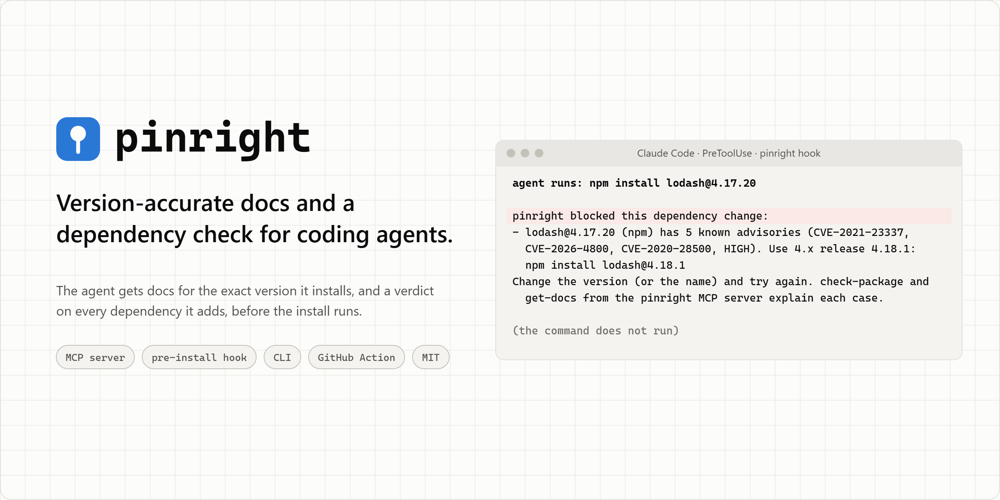

<picture>
  <source media="(prefers-color-scheme: dark)" srcset="https://raw.githubusercontent.com/Hiper-AI/pinright/main/assets/cover-dark.png">
  
</picture>

# pinright

**Version-accurate docs and a dependency check for coding agents.** Your agent gets library
versions from one of two places: its memory, where about 40% of the pins it wrote in our benchmark
carried a known advisory, or a docs MCP server, which returns documentation and does not check the
version against advisories. pinright gives it the docs for the exact version it installs and a
verdict on every dependency it adds, before the install runs. MCP server, pre-install hook, CLI and
GitHub Action, all local.

[](https://www.npmjs.com/package/pinright)
[](https://github.com/Hiper-AI/pinright/actions/workflows/ci.yml)
[](https://github.com/Hiper-AI/pinright/blob/main/LICENSE)
[](https://cursor.com/en/install-mcp?name=pinright&config=eyJjb21tYW5kIjoibnB4IiwiYXJncyI6WyIteSIsInBpbnJpZ2h0Il19)
[](https://insiders.vscode.dev/redirect?url=vscode%3Amcp%2Finstall%3F%257B%2522name%2522%253A%2522pinright%2522%252C%2522type%2522%253A%2522stdio%2522%252C%2522command%2522%253A%2522npx%2522%252C%2522args%2522%253A%255B%2522-y%2522%252C%2522pinright%2522%255D%257D)

## Install

Node 20.9 or newer. One line, then restart the agent:

```bash
npm i -g pinright && pinright init --user   # just you, every project; the hook starts in about 0.2 s
npx -y pinright init                        # your team: writes project files you commit
```

`init` wires the MCP server, the pre-install hook where the client has one, and a starter
`.pinright.json`. 16 clients; six have a hook: Claude Code, Cursor, VS Code (GitHub Copilot),
OpenAI Codex, Gemini CLI and Windsurf. The Cursor and VS Code buttons above add the MCP server
only. [Every client, scopes and `pinright doctor`](https://github.com/Hiper-AI/pinright/blob/main/docs/install.md).

## Without pinright, with pinright

**Without.** The agent runs `npm install lodash@4.17.20`. It installs. The lockfile now carries
five advisories, two of them high, and nobody is told.

**With.** The hook answers before the command runs, and the agent reads this:

```
pinright blocked this dependency change:
- lodash@4.17.20 (npm) has 5 known advisories (CVE-2021-23337, CVE-2026-4800, CVE-2020-28500, HIGH). Use 4.x release 4.18.1: npm install lodash@4.18.1
Change the version (or the name) and try again. check-package and get-docs from the pinright MCP server explain each case.
```

The agent retries with `4.18.1`, on the same release line. When it asks first, `check-package`
and `get-docs` give it the same verdict with the full advisory list, the version to pin, and the
docs for that version. Real output of `pinright hook claude`, 2026-11-01.

## Why pinright

Docs MCP servers return documentation for a library. They do not check the version the agent pins,
and they do not see the install. To measure that kind of server we ran pinright's own server with its
security layer off (`PINRIGHT_ABLATION=docs-only`): docs for the version asked, no verdict. It is not
another product. Claude Code with Sonnet 5.5, Haiku 5.5 and Opus 5.5, 2 runs per cell, on the 1.0.0
code; each cell gives the range over the three models.

| | No docs | Docs-only context server | pinright |
|---|---|---|---|
| Direct dependencies pinned with a known advisory | 40% to 42% | 0% to 2% | 0% |
| Whole-tree alerts per project (`npm audit`, `pip-audit`) | 29.8 to 31.9 | 0.3 to 3.5 | 0.3 |
| Docs tasks that used the current API | 9 to 14 of 16 | 15 or 16 of 16 | 16 of 16 |
| Tokens per agent task | 15k to 21k | 56k to 94k | 42k to 74k |
| Tokens per docs task | 17k to 23k | 94k to 135k | 63k to 95k |
| Agent turns per agent task | 4.0 to 4.3 | 9.3 to 11.1 | 5.9 to 7.5 |
| MCP tool text read per agent task | none | 25k to 45k characters | 5k to 17k characters |
| Verdict on the version the agent pins | no | no | advisories, malware, lookalikes, versions that do not exist |
| Check when the install runs | no | no | pre-install hook in 6 clients |
| Whole-tree lockfile audit | no | no | `check-manifest`, SARIF, GitHub Action |

Current docs alone removed most alerts; the verdict removed the rest. Per model, pinright used 21% to
26% fewer tokens than the docs-only server on the 12 agent tasks and 26% to 33% fewer on the 8 docs
tasks. Every paired interval stays above zero; the lowest bound is 2%. Tokens count everything the
model processed, cache reads included. No tools at all costs less than either.

**Why fewer tokens.** With docs only, the agent looked versions up through the docs: it called
`get-docs` once per package, 5.2 to 5.7 times per agent task, before writing a file. 87% of those calls
named no version, so they returned the docs of the latest release, and 75% asked for "version" or
"latest" in the query. With pinright, every agent-task run opened with `check-packages` for the whole
list, about 600 characters of verdicts and versions to pin, then called `get-docs` 0.7 to 1.7 times per
task, with a version in 86 of 87 calls.

**Limits.** The 0.3 left is nuxt, whose current release pulls packages with no fix published;
installing with no version gets the same 0.3, and the docs-only and pinright alert intervals overlap.
One vendor's models, tasks we wrote, no shell, two days of advisory data, small n. In a second run
with a shell, the agents looked versions up with `npm view` or `pip index` before pinning, and every
arm ended at the same 6 alerts per model: there pinright made no measurable difference to the pins.
On APIs released after August 2026, 2 of 48 runs got the current API without docs, 45 of 48 with docs
only and 46 of 48 with pinright. On 12 tasks taken from public GitHub issues, 25% to 29% of direct
pins carried an advisory without docs and none with pinright. The hook blocked or asked on 1.46% of 25,077 public commands and
misread 10 of 154,402 tool calls from a month of our own agent sessions.
[Per-model tables](https://github.com/Hiper-AI/pinright/blob/main/docs/benchmark.md#efficiency-tokens-turns-and-cost-against-a-docs-only-server) ·
[results and caveats](https://github.com/Hiper-AI/pinright/blob/main/bench/RESULTS-v7.md) ·
[technical report](https://github.com/Hiper-AI/pinright/blob/main/paper/kit/pinright-report.md) ·
[reproduce it](https://github.com/Hiper-AI/pinright/blob/main/bench/RESULTS-v7.md#reproduce)

### Against a widely used docs MCP server

People ask how pinright compares with the docs MCP servers they already use. We added one, a widely
used local server with a free API key, as an arm of the same benchmarks: run v8, 2026-11-04, every arm
on the same day and the same advisory data. Range over Sonnet 5.5, Haiku 5.5 and Opus 5.5, 2 runs per
cell.

| | No tools | Docs MCP server | pinright | Both installed |
|---|---|---|---|---|
| Direct deps pinned with a known advisory, our 12 tasks | 40% to 41% | 28% to 35% | **0%** | **0%** |
| Same, 12 tasks taken from GitHub issues | 27% to 32% | 15% to 21% | **0%** | **0%** |
| Whole-tree alerts per project, our 12 tasks | 29.4 to 33.0 | 14.7 to 18.6 | **0.3** | **0.3** |
| Docs tasks that used the current API (of 16) | 10 to 12 | 12 to 16 | **14 to 16** | n/a |
| Same, APIs released after the training cutoff (of 16) | 0 or 1 | 11 or 13 ¹ | **16** | n/a |
| Tokens per agent task | 15k to 21k | **47k to 61k** | 43k to 80k | 53k to 84k |
| Tokens per docs task | 17k to 22k | **53k to 77k** | 70k to 105k | n/a |
| Checks the version the agent pins | no | no | yes | yes |
| Stops the install of a vulnerable version | no | no | pre-install hook | pre-install hook |

¹ Sonnet and Haiku; the free key hit its monthly quota during the Opus runs.

The docs MCP server moved agents to newer versions and halved the alerts, but it does not check the
version the agent picks: its most common vulnerable pin was `next@16.2.9` (20 advisories, 11 runs), the
Next.js version it served docs for. It used fewer tokens than pinright in most cells, because its
answers are shorter. With both installed, the agent took its versions from pinright and called the docs
server 6 times in 144 runs. One docs server, one release, tasks we wrote or picked, no shell.
[Per-model tables](https://github.com/Hiper-AI/pinright/blob/main/docs/benchmark.md#against-a-docs-mcp-server)

## Ask your agent

- "Add zod and pin a version with no known advisories."
- "Show me the docs for the version of next this project has installed."
- "Audit package-lock.json and tell me what to upgrade, on the same release lines."
- "What changed between express 4 and 5 before I move?"

## Tools

| Tool | What it does |
|---|---|
| `check-packages` | The verdict for up to 50 packages in one call: version to pin, short reason, full notice only where it matters |
| `check-package` | One package in depth: advisories with CVE and fix, deprecation, license, lookalike names, policy violations |
| `get-docs` | Docs from the published package and its repo at the release tag, for the version you name or the one installed |
| `find-library` | Library name to registry package (`next.js` to `npm:next`), with the safe version |
| `upgrade-guide` | What changes between two versions: breaking changes, renamed APIs, advisories the move fixes |
| `check-manifest` | Whole-tree audit of a lockfile or manifest, with SARIF; the GitHub Action runs it in CI |

Ecosystems: npm, PyPI, Cargo, Go, Maven and Gradle, NuGet, RubyGems, Composer, GitHub Actions.
Verdicts never say `ok` when a source did not answer. A committed `.pinright.json` sets allow and
deny lists, license rules, severity threshold and what to do when a source is down.
[How it works](https://github.com/Hiper-AI/pinright/blob/main/docs/how-it-works.md) ·
[the hook](https://github.com/Hiper-AI/pinright/blob/main/docs/hook.md) ·
[team policy](https://github.com/Hiper-AI/pinright/blob/main/docs/policy.md) ·
[CLI](https://github.com/Hiper-AI/pinright/blob/main/docs/cli.md) ·
[GitHub Action](https://github.com/Hiper-AI/pinright/blob/main/docs/action.md)

## Privacy and limits

No account, no telemetry. pinright sends package names and versions to deps.dev, OSV, the
registries, jsDelivr and GitHub, never your code;
[SECURITY.md](https://github.com/Hiper-AI/pinright/blob/main/SECURITY.md#what-it-sends-over-the-network-and-to-whom)
lists each host. The hook reads commands and files statically: it is a guardrail, not a sandbox,
and the [threat model](https://github.com/Hiper-AI/pinright/blob/main/docs/HOOK-THREAT-MODEL.md)
lists what gets past it. When a source is down the built-in default lets the install through;
the starter policy asks instead.

## More

[Install](https://github.com/Hiper-AI/pinright/blob/main/docs/install.md) ·
[prompt injection](https://github.com/Hiper-AI/pinright/blob/main/docs/prompt-injection.md) ·
[benchmark](https://github.com/Hiper-AI/pinright/blob/main/docs/benchmark.md) ·
[security review](https://github.com/Hiper-AI/pinright/blob/main/docs/SECURITY-REVIEW.md) ·
[changelog](https://github.com/Hiper-AI/pinright/blob/main/CHANGELOG.md) ·
[contributing](https://github.com/Hiper-AI/pinright/blob/main/CONTRIBUTING.md) ·
[release runbook](https://github.com/Hiper-AI/pinright/blob/main/docs/RELEASE.md)

The report we value most is a false positive: a command the hook blocked, or a package it
flagged, that should have passed. Open an issue with the template and paste the command and the
output of `npx pinright doctor --json`. Report a vulnerability in pinright privately, as
[SECURITY.md](https://github.com/Hiper-AI/pinright/blob/main/SECURITY.md) describes.

MIT. Built by [Hiper AI](https://hiperai.com) ([opensource@hiperai.com](mailto:opensource@hiperai.com)).
Site: [pinright.dev](https://pinright.dev). Everyone taking part follows the
[Code of Conduct](https://github.com/Hiper-AI/pinright/blob/main/CODE_OF_CONDUCT.md).
