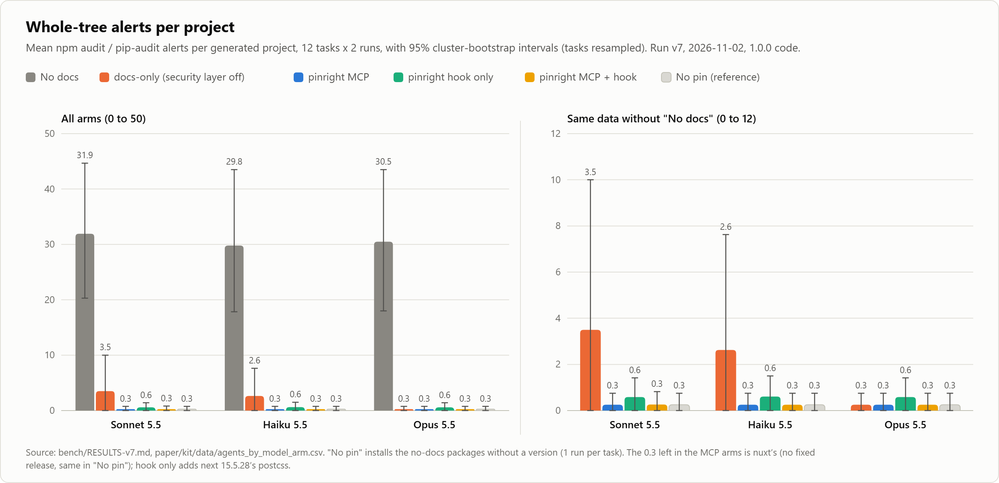

# Benchmark

Three measurements, all from run v7 of 2026-11-02 and 2026-11-03 on the 1.0.0 code: what versions an
agent pins, whether it writes the current API of a library, and how often the hook gets in the way of
ordinary commands. The data, per-task tables and failure diagnoses are in [bench/](../bench/); the
technical report ([PDF](https://pinright.dev/report.pdf), [Markdown](../paper/kit/pinright-report.md))
covers method and limits in full.

## Dependencies: does the agent pin vulnerable versions?

Claude Code in headless mode, driving Sonnet 5.5, Haiku 5.5 and Opus 5.5, on 12 coding tasks (8 npm,
4 PyPI) that ask for pinned versions, twice per arm and model. We audit each project with `npm audit`
or `pip-audit`, which share nothing with pinright, and install and build it for real. Run v7;
summary and caveats in [bench/RESULTS-v7.md](../bench/RESULTS-v7.md), full report in
[bench/AGENTS.md](../bench/AGENTS.md):

| Whole-tree alerts, sum over 24 projects (direct deps with an advisory) | Sonnet 5.5 | Haiku 5.5 | Opus 5.5 |
|---|---|---|---|
| No docs | 766 (40%) | 715 (40%) | 732 (42%) |
| docs-only (pinright with the security layer off) | 84 (2%) | 63 (2%) | 6 (0%) |
| pinright MCP | 6 (0%) | 6 (0%) | 6 (0%) |
| pinright hook only | 14 (0%) | 14 (0%) | 14 (0%) |
| pinright MCP + hook | 6 (0%) | 6 (0%) | 6 (0%) |
| Projects that build, pinright MCP | 23/24 | 23/24 | 24/24 |
| API-equivalent cost per run, no docs / pinright MCP (USD, list price) | 0.033 / 0.050 | 0.003 / 0.006 | 0.074 / 0.126 |

The 6 alerts left in the MCP arms are all nuxt's: its current release pulls `deepmerge`, `glob` and
`minimatch` versions with advisories and no fix yet, and installing nuxt without a pin gets the same 3
per project. docs-only is an ablation: the same server with its verdict turned off, documenting each
package's latest release. Steering the agent to current versions that way already removes most of
the alerts. The verdict removes the rest: without it, Sonnet pinned a vulnerable `next` in both of its
next-auth runs and Haiku `next-auth` betas with advisories in both of its own, and the runs took more
turns and cost more. On the same 394 lockfiles, `check-manifest` flagged the same vulnerable packages
as `npm audit` and `pip-audit` (mean Jaccard 0.96 for npm, 1.00 for PyPI).

<picture>
  <source media="(prefers-color-scheme: dark)" srcset="../paper/kit/figures/fig-a-alerts-per-project-dark.png">
  
</picture>

Mean alerts per project, with 95% cluster-bootstrap intervals that resample tasks
([caption and source](../paper/kit/figures/fig-a-alerts-per-project.caption.md)).

## Docs: does the agent write the current API?

Eight tasks that only come out right with a library's current major (Next.js 16, Tailwind CSS 4,
Zod 4, AI SDK 7, Express 5, ESLint 10, Pydantic 2, LangChain 1), twice per arm and model. Each
project is installed, built, smoke-tested at runtime and checked for new, removed and deprecated
APIs. Report and per-task diagnosis in [bench/DOCS.md](../bench/DOCS.md):

| Current API (works, right major, all checks pass) | Sonnet 5.5 | Haiku 5.5 | Opus 5.5 |
|---|---|---|---|
| No docs | 13 / 16 | 9 / 16 | 14 / 16 |
| docs-only (pinright with the security layer off) | 16 / 16 | 15 / 16 | 16 / 16 |
| pinright | 16 / 16 | 16 / 16 | 16 / 16 |

Without docs every model wrote AI SDK 5/6 code for AI SDK 7, and half the LangChain runs pinned an
early 1.x (1.0.3 or 1.2.0) that fails to import, a version problem more than a docs problem. The
models already knew most of the eight APIs, so the gap rests on a few, and the no-docs intervals
for Sonnet and Opus overlap 16 of 16. A second set of eight APIs released after August 2026
separates the arms more: 2 of 48 runs without docs, 46 of 48 with pinright
([bench/RESULTS-post-cutoff.md](../bench/RESULTS-post-cutoff.md)). Without an agent, pinright's docs
answer 24 of 25 questions on the first set's tasks and 133 of 154 held-out questions over 56 other
libraries with the current API.

## Hook: how often does it get in the way?

We replayed 25,077 commands and file writes (14,902 distinct) from 180 public repositories through
`pinright hook claude` with the default policy: GitHub Actions `run:` steps, package.json scripts,
README and CONTRIBUTING shell lines, Dockerfile `RUN` instructions, Makefile and justfile recipes, and
manifest writes. The hook blocked or asked on 1.46% of them, and denied 0.13% of the entries without
GitHub's `${{ }}` templating. Some of those are true positives, such as a public workflow that
installs `pnpm@8` with 26 advisories. Per-source rates, the root causes we fixed and what still blocks
are in [bench/fp/RESULTS.md](../bench/fp/RESULTS.md).

We also replayed a month of our own Claude Code sessions, 154,402 distinct tool calls. Read by hand,
the hook misread 10 of them after the fixes that replay prompted, against 52 true positives and 79
asks by design ([Real agent sessions](../bench/fp/RESULTS.md#real-agent-sessions-2026-11-02)).

The prompt-injection scanner has its own measurements on real docs and an adversarial corpus: see
[Prompt injection](prompt-injection.md) and
[bench/injection/RESULTS.md](../bench/injection/RESULTS.md). Hook latency is in
[The hook](hook.md#latency).

## Caveats

- Every agent is Claude Code driving a Claude model. The hook supports Codex, Gemini CLI and others;
  this benchmark does not show how they behave.
- We wrote the tasks. They ask for exact pins and name the libraries, which favors a tool that
  answers version questions. A set of 12 tasks taken from public GitHub issues tests this
  ([bench/RESULTS-real-issues.md](../bench/RESULTS-real-issues.md)).
- n is small: 24 runs per arm and model in the agent benchmark, 16 in the docs benchmark.
- The advisory data is from the two days of the run, 2026-11-02 and 2026-11-03. A version clean
  today can carry advisories tomorrow.
- Agents had only Write and Read, no shell, so the hook saw manifest writes and no install commands.
  In a second run with a shell ([bench/RESULTS-shell.md](../bench/RESULTS-shell.md)), the agents
  looked versions up with `npm view` or `pip index versions` before pinning, and every arm, with or
  without pinright, ended at the same 6 alerts per model.

These numbers are not a promise. The share of direct dependencies with an advisory is counted
through pinright's own deps.dev client; the whole-tree alerts from `npm audit` and `pip-audit` are
the independent measure, and installing with no version at all gets the same 0.3. The full list of
caveats is in [bench/RESULTS-v7.md](../bench/RESULTS-v7.md#caveats). The previous run, v6, ran on a
pre-release commit and is kept as [bench/RESULTS-v6.md](../bench/RESULTS-v6.md).

## Reproduce

The commands for every run, model and report, and what you need installed, are in
[bench/RESULTS-v7.md](../bench/RESULTS-v7.md#reproduce). The raw transcripts are not published; only
the aggregate CSVs are. The agent harness lives in
[bench/agents/](../bench/agents/) (`npm run bench:agents`), the docs harness in
[bench/docs/](../bench/docs/) and the hook replay in [bench/fp/](../bench/fp/). The figures and the
CSVs behind the report regenerate with `npx tsx paper/kit/make-data.ts --agents <stamps> --docs
<stamps>` and `npx tsx paper/kit/make-figures.ts`; [paper/kit/claims.md](../paper/kit/claims.md) maps
every number to its source.
