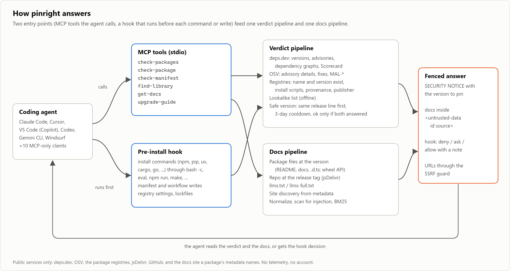
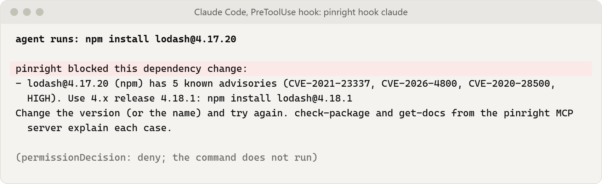
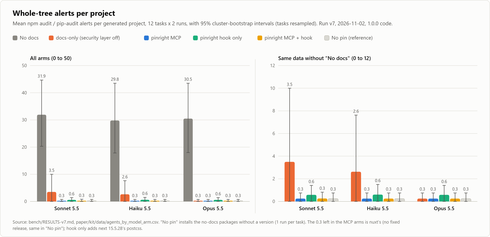
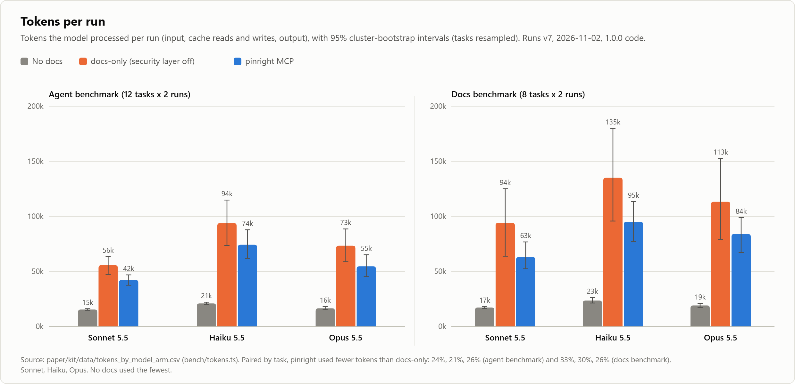
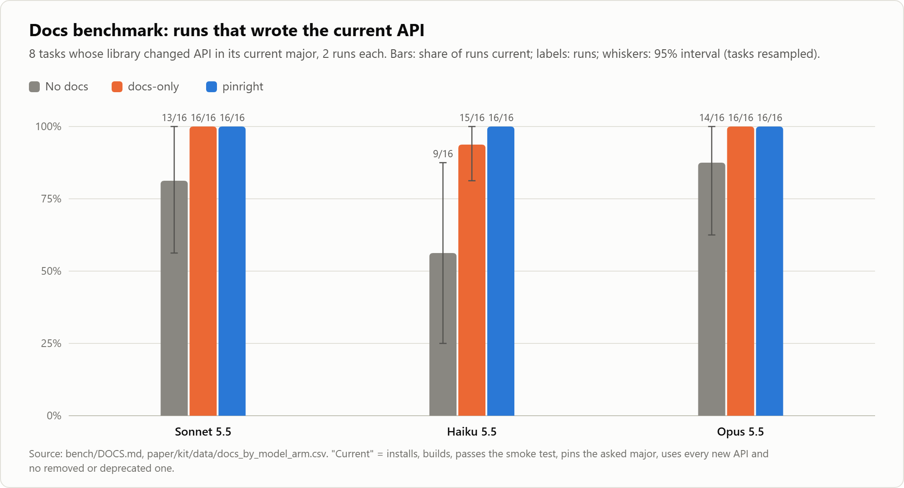
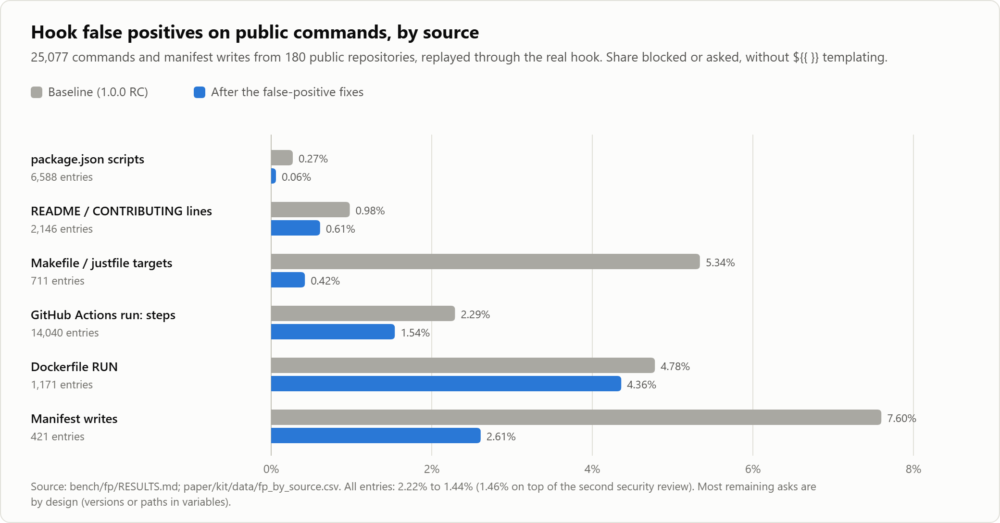

# pinright: version-accurate library docs and a supply-chain verdict for coding agents

**Juan Pablo Mandelbaum**, principal investigator and pinright lead, Hiper AI
(opensource@hiperai.com)

Technical report, version 1.0.0, 2026-11-03. Code: <https://github.com/Hiper-AI/pinright> (MIT). Site:
<https://pinright.dev>. This report has not been peer reviewed. It describes pinright 1.0.0. The
agent and docs benchmarks (run v7) ran on 2026-11-02 and 2026-11-03 against commit `8efc4f0`, whose
`src/` is the 1.0.0 release. An earlier run, v6, used a pre-release commit and is kept in
`bench/RESULTS-v6.md`. Section 5 lists every run.

## Abstract

Coding agents pick dependency versions from what their model saw in training, and those versions
often carry advisories published since. We measured this with Claude Code driving three models
(Sonnet 5.5, Haiku 5.5, Opus 5.5) on 12 tasks we wrote (8 npm, 4 PyPI), two runs each, scored with
`npm audit` and `pip-audit`. With file tools only and nothing attached, 40% to 42% of the direct
dependencies each model pinned had a known advisory, and projects averaged 30 to 32 whole-tree
alerts. pinright, an MIT-licensed MCP server, CLI, pre-install hook and GitHub Action, gives the agent
a verdict on each dependency (advisories, malware records, lookalike and nonexistent names) and docs
from the package at the version it will install. With its security layer off, documenting the latest
release, pinright already cut alerts to 84, 63 and 6 over 24 projects per model: current versions
remove most of the exposure. The full server brought each model to 6 alerts, all from one nuxt
dependency with no fixed release, and 0 vulnerable direct pins, using 21% to 33% fewer tokens per
run than the docs-only ablation and more than no tools. Given a shell, the agents looked versions up
with `npm view` or `pip index versions`, and every arm, with or without pinright, ended at the same 6
alerts: there pinright made no measurable difference to the pins. With pinright's docs, all three
models wrote the current API of eight recently changed libraries in 16 of 16 runs, against 9 to 14
without. The hook blocked or asked about 1.46% of 25,077 public commands. These results come from one
vendor's models, two days of advisory data, tasks we wrote, and two repetitions.

## 1. Problem

A coding agent that adds a dependency today gets its version from one of two sources. The first is
its own memory: the model's training data, which stops at a cutoff. The second is a docs tool, such as
an MCP server that returns library documentation. Neither source checks the version against
advisories. Memory gives old versions, many with advisories published since (Section 1.1). A docs
tool moves the agent toward current releases, which removes most of that exposure, but it does not
tell the agent whether the version it pins is vulnerable, and agents still pin vulnerable versions
with one (Section 1.2). pinright adds that check at the moment the agent chooses the version and again
when the install runs.

### 1.1 Agents pin from memory

When a coding agent writes `package.json` or `requirements.txt`, it has to pick a version for each
dependency. Unless a tool tells it otherwise, it picks one it remembers. Training data stops at a
cutoff and over-represents versions that stayed popular for a long time, so the agent tends to pin a
release from a year or two before the model shipped. Many of those releases have advisories
published since.

Our v7 agent benchmark (Section 5.1) measured the effect for three models. With no tools attached,
each model pinned 157 to 164 direct dependencies over 24 projects, and 63 to 66 of them (40% to 42%) had at
least one advisory in OSV. The median pinned version was 607 to 717 days old. Examples from the
transcripts: `axios@1.7.9` (33 advisories), `pillow@11.0.0` (86), `pyjwt@2.10.1` (32),
`next@15.1.6` (36). The resolved trees produced 715 to 766 alerts per model, 164 to 178 of them
critical or high in the npm projects. Four of 72 projects came out clean.

The package choices were fine. The same packages installed without a version (the *no pin*
reference arm) produced 3 alerts over 12 projects, all in the dependencies of the current `nuxt`
release, which have no fixed version yet.

### 1.2 Docs tools move the version but do not check it

If the versions are the problem, any tool that moves the agent to current releases should help, and
our ablation (Section 5.2) shows that it does. pinright with its security layer switched off
documents the registry's latest release when asked without a version. Agents using it asked for the
latest release package by package and pinned it, and whole-tree alerts fell by 89% to 99% from the
no-docs arm.

That leaves cases a docs tool does not handle. An agent has reasons to pin an older version: a peer
range (`next-auth` 4 wants `next` 15), an existing lockfile, a pre-release it read about. Without a
verdict it cannot tell a vulnerable old release from a clean one, and in 4 of the 72 docs-only runs
it pinned a vulnerable `next` or `next-auth`: Sonnet `next@15.5.0` (32 advisories) in both next-auth
runs, and Haiku `next-auth` betas with advisories in both of its own. The docs-only and pinright
intervals overlap (Section 5.2), so this is an observation on these tasks, not a measured rate. A docs tool also says
nothing about lookalike names, packages that do not exist, or malware, and it helps only when the
agent calls it. pinright adds those pieces: a verdict on the version being pinned, a fix on the same
release line, refusal of malicious, lookalike and nonexistent names, and a hook that runs whether or
not the agent asked. We did not benchmark any third-party docs service and make no claim about how
one behaves.

### 1.3 Related work

pinright combines pieces that exist separately.

- **Advisory data.** OSV aggregates advisories across ecosystems, including the GitHub Advisory
  Database and malicious-package records (`MAL-*`). deps.dev mirrors OSV and adds version lists,
  licenses, resolved dependency graphs and OpenSSF Scorecard results. pinright is a client of both and
  adds no advisory data of its own.
- **Dependency scanners** such as `npm audit`, `pip-audit` and OSV-Scanner audit a lockfile after the
  fact; Dependabot and Renovate open pull requests to move vulnerable or outdated dependencies. They
  act after a dependency entered the repository. pinright acts while the agent chooses it, and also
  ships a scanner (`pinright audit`) for CI.
- **Docs MCP servers.** Several MCP servers give coding agents library documentation. They return
  docs for a library; they do not check the version the agent pins, and they do not see the
  install. We did not test any of them. The docs-only arm in Section 5.2 is pinright's own ablation,
  not another product.
- **Install-time guards.** Proxy registries and package firewalls block known-bad packages for every
  client of a registry. They see the package request, not the agent's intent, and return no
  recommended version or docs to the agent. Our threat model recommends running one next to pinright.
- **Package hallucination.** Spracklen et al. ("We Have a Package for You!", USENIX Security 2025)
  measured code-generating models inventing package names that attackers can register. pinright's
  lookalike and registry-existence checks target that pattern. In the v7 runs no arm pinned a package
  or version that does not exist.
- **Provenance.** npm provenance attestations (Sigstore) tie a tarball to the workflow that built it.
  pinright reads them as a signal and publishes its own releases with them.

## 2. Overview

pinright is a TypeScript program for Node 20.9 or newer, published as one npm package with four
direct runtime dependencies. It runs in four modes:

| Mode | Entry point | What it does |
|---|---|---|
| MCP server (stdio) | `npx pinright` | Six tools: `find-library`, `get-docs`, `upgrade-guide`, `check-package`, `check-packages`, `check-manifest` |
| CLI | `pinright check`, `audit`, `upgrade`, `doctor`, `init`, `cache` | The same checks for people and CI; `init` wires the server and hook into agent clients |
| Pre-install hook | `pinright hook <agent>` | Reads the agent's next shell command or file write and denies, asks or allows |
| GitHub Action | `action.yml` at the repository root | Runs `audit`, writes a job summary, annotates the PR and uploads SARIF |

`init` covers 16 clients; for JetBrains AI Assistant it prints the JSON to paste. Six have a hook
interface that pinright wires: Claude Code, Cursor, VS Code with GitHub Copilot (a preview hook API),
OpenAI Codex, Gemini CLI and Windsurf. The others get the MCP server only.

The program sends no telemetry. It talks to public services only: deps.dev, OSV, the package
registries, jsDelivr, GitHub, and the docs site a package's metadata names. Lookups are cached on
disk: advisories and versions for 24 hours, docs for 7 days, file listings of a release tag for a
year. Figure 1 shows how the parts connect.



*Figure 1. The agent calls MCP tools, or the hook runs before its next command or write. Both use the
verdict pipeline; the tools also use the docs pipeline. Answers come back fenced.*

## 3. Design

### 3.1 The verdict

A check takes an ecosystem, a package name and optionally a version. Without a version, pinright
reads the project's lockfile or manifest (Section 3.6) and checks the installed one.

**Sources.** deps.dev supplies the version list, per-version advisories, deprecation, licenses,
dependency graphs and Scorecard. OSV supplies advisory details, fixed versions, severity and malware
records. The npm registry supplies per-version documents for supply-chain signals; the npm downloads
API and pypistats.org supply download counts. Composer has no deps.dev coverage, so pinright reads
`repo.packagist.org` and advisories from OSV and Packagist. GitHub Actions refs resolve through one
git request per repository and OSV's `GitHub Actions` ecosystem.

**Verdicts.** `ok`, `vulnerable`, `malicious`, `deprecated`, `possible-typosquat`,
`unknown-package` and `unknown`. pinright answers `ok` only when both deps.dev and OSV answered. If
either fails, the verdict is `unknown` and names the host and cause. With OSV down, a version
deps.dev already flags stays `vulnerable`, and one deps.dev calls clean becomes `unknown`, because
deps.dev mirrors OSV with a lag of hours and malware reports reach OSV first. A `malicious` or
`unknown-package` result for the requested version overrides any package-wide headline (finding F3,
Section 4.4).

**Safe version.** The newest release that is stable (no pre-release tags, no Go pseudo-versions),
not deprecated, free of advisories in both deps.dev and OSV, and older than a cooldown of 3 days
(`PINRIGHT_COOLDOWN_DAYS`). pinright inspects up to 12 candidates, newest first. Registries usually
pull compromised releases within days; a team can raise the cooldown in `.pinright.json`.

**Release lines.** When the agent asks about a specific version, pinright computes its release line:
the major (`3.x`), or the minor before 1.0 (`0.28.x`). The recommendation follows one order,
used by the notice, the hook, the batch check, audit fixes and the upgrade guide: (1) the newest
clean release on the same line; (2) otherwise the newest clean release on the nearest newer line
that has one, up to four lines ahead, so a Spring 5.3 project is pointed at 6.2.x and not at 7.0;
(3) otherwise the newest clean release overall. When nothing is clean, the report names the least
exposed version. When the recommended major is less than a year old, the notice points the agent at
that version's docs.

**Transitive trees.** For npm, PyPI, Cargo, Maven and Composer, where pinright has resolved graphs, a
clean same-line release can still pull vulnerable dependencies. `next` 15.5.28 pins a `postcss` with
advisories that only Next 16 clears. pinright keeps the same-line recommendation and adds a note
naming the vulnerable pulls and the line that clears them. When a vulnerable pin is a dependency of
another pinned package, the hook points at the parent upgrade, so the fix installs.

**Supply-chain signals.** Advisories lag attacks by days, so pinright also reports signals for the
version the agent would install. They never change the verdict; the hook acts on two of them
(Section 3.3).

| Signal | Source | Level |
|---|---|---|
| Install scripts (`preinstall`, `install`, `postinstall`, implicit `node-gyp`) | npm version document | `info`; `warn` when earlier releases had none; `high` for a package younger than 14 days or scripts that arrive with a new publisher |
| Provenance dropped | npm version document | `warn`; `high` with a new publisher |
| Publisher change (none of the previous five releases came from that account) | npm `_npmUser` | `warn`; `info` if already a maintainer or the release has provenance |
| Young package with low weekly downloads | deps.dev, npm downloads, pypistats.org | `warn` under 100 a week |
| OpenSSF Scorecard below 4, or a dangerous workflow | deps.dev | `info` |
| The package's own text addresses AI agents (Section 4.1) | pinright's cache | `warn` |

**Lookalike names.** A name one edit away (Damerau-Levenshtein, optimal string alignment) from one
of 3,627 popular npm names or 3,001 PyPI names counts as a lookalike; for names of seven or more
characters near the 1,000 most popular, two edits count. A package older than the cooldown with
50,000 or more weekly downloads of its own passes. The list ships with pinright, so this check
works offline. For npm and PyPI, pinright also checks that the name exists in the registry, which
catches hallucinated names.

### 3.2 Docs

`get-docs` takes a library id, a question and an optional version, and returns ranked sections under a
budget of about 2,500 tokens (10,000 characters). If the version is vulnerable, the answer opens with
a security notice and documents the recommended same-line version instead, so docs and pin agree.

**Sources.** pinright calls no docs index. At the exact version it gathers (1) the published package
through jsDelivr: README, bundled docs and `.d.ts` files for npm; for PyPI the wheel or sdist, read
as text and never imported (public signatures and docstrings, `.pyi` stubs, typeshed stubs when the
distribution ships no types; archive readers stop at 64 MB); (2) the source repository at the release
tag through jsDelivr's GitHub mirror, with the GitHub API as fallback for repositories over 50 MB,
skipping translations, contributor and agent notes, eval prompts, example apps and copies of older
majors, and inlining code a page includes from another file; (3) the project's `llms.txt` or
`llms-full.txt`, found from the registry's homepage or docs URL, the homepage the repository
declares, or the README's docs link, and labeled as current-site docs because they may be newer than
the pinned version. A hand-written map covers packages none of these paths find (LangChain, PyYAML,
Tailwind CSS). Every URL that comes from metadata goes through the SSRF guard (Section 4.2).

**Ranking.** pinright splits documents by heading, normalizes each section and scans it for prompt
injection (Section 4.1), then ranks locally with BM25 (k1 = 1.2, b = 0.75). Path hits count by how
rare the matched word is in the tree. A question that asks several things is split on `;`, `,` and
`:`, and each topic gets its best section first. A near-duplicate filter drops sections that share
70% of their words with one already picked. Files that declare themselves generated weigh half for
how-to questions.

**Rename hints.** An agent asks with the names it learned. pinright reads renames from the package
itself (`@deprecated Use X instead` in type definitions, deprecation decorators in Python, the
current major's migration guide). When a question uses an old name, the new one joins the query and
the answer opens with a fenced line such as "Renamed or deprecated in ai@7.0.157, per the package's
own files: `system` -> `instructions`". No library has a hand-written rename entry.

**Upgrade guides.** `upgrade-guide` returns what changes between two versions: changelog sections,
GitHub release notes in the range, migration guides across a major, and for npm a diff of exported
API between the two `.d.ts` sets. Entries are tagged `BREAKING`, `CONFIG/DEFAULT`, `NEW PACKAGE` or
`DEPRECATED`, and the answer opens with the advisories the move fixes.

### 3.3 The hook

The MCP tools help only when the agent calls them. `pinright hook <agent>` runs before each shell
command and file write the agent makes, reads the client's hook payload, and answers in that client's
format. Figure 2 shows the answer for `npm install lodash@4.17.20`.



*Figure 2. The hook's real answer (pinright 1.0.0, 2026-11-01). The command does not run; the agent
gets the reason and the version to use.*

**What it reads.** Install commands for npm, pnpm, yarn, bun, npx, pip, uv, uvx, pipx, poetry, pdm,
cargo, go, gem, bundle, dotnet and composer, through what a command runs: `bash -c`, `eval`, `$(...)`,
`cmd /c`, `powershell -Command` and `-EncodedCommand`, wrappers such as `sudo`, `env` and `xargs`,
aliases and variables set on the same line, and scripts run by name (`npm run`, lifecycle scripts,
`make`, `just`, `sh script.sh`), read from disk. Writes to manifests, through the write tool, Codex's
`apply_patch`, a notebook cell or a shell redirect; only dependencies that are new or change version
count. Writes to workflows (new or re-pointed `uses:` lines), registry settings and lockfiles.

**Policy.** The hook denies malware, lookalike names, names or versions that do not exist, versions
with advisories when a clean one exists, deprecated versions with a maintained successor,
dependencies whose transitive tree has advisories that a same-line upgrade clears, manifests whose
pins contradict each other, and two supply-chain patterns: a package younger than 14 days that runs
install scripts, and a release that adds install scripts from a new publisher. With no clean version,
it asks a human for high and critical advisories and lets the rest through with a note.

**Unverifiable means ask.** A package name in an unknown variable, input `xargs` reads from a pipe, a
git or URL source, another registry, or a manifest rewritten with `sed -i` is unverifiable, and the
default policy asks a human. A change to pinright's own configuration always asks. A change that adds
more than 40 dependencies asks too, so padding cannot push a bad package past the check.

**Failure and the deadline.** When deps.dev or OSV cannot answer, the hook applies `onError`. The
built-in default is `allow` with a note, so an offline laptop keeps working; the starter
`.pinright.json` that `init` writes sets `ask`. Lookalike names, the deny list and unverifiable
sources still decide offline. The agents give a hook 60 seconds and then run the tool anyway, so
pinright keeps its own 45-second deadline and asks a human when it runs out. Codex, Gemini CLI and
Windsurf have no "ask" answer, so pinright denies there and gives the reason. The hook answers on
stdout with exit code 0 (Windsurf: exit 2 with the reason on stderr). An exception while deciding
asks a human. Input that is not JSON exits 1, which the agents treat as a non-blocking error; the
agent application builds that JSON, not the model.

**Undeclared imports.** When the agent writes Python or JS/TS source, the hook notes packages it
imports but no manifest declares, with a clean version to pin. It never blocks on this.

### 3.4 Audit, SARIF and the GitHub Action

`pinright audit` reads lockfiles for npm, pnpm, yarn, pip, poetry, uv, pdm, Cargo, Go, RubyGems,
NuGet, Gradle and Composer, or resolves a bare manifest through deps.dev, and reports every advisory
in the tree with its dependency chain and fix. Exit codes are 0 (clean), 1 (findings at or above
`--fail-on`) and 2 (bad input). Malware, lookalikes, policy denials and missing action refs fail the
run at any threshold except `none`; advisories that could not be rated because OSV failed also fail
it (F5). `--sarif` writes SARIF 2.1.0 with one rule per advisory and a `primaryLocationLineHash`
built from rule, file and package without line or version, so code scanning keeps one alert per
advisory and package across lockfile churn.

The Action bundles its own code and installs nothing from npm at run time. On pull requests it reads
`.pinright.json` from the base commit, never from the PR's tree, so a PR cannot loosen its own
review; an unreadable base fails the step. Reports print between `::stop-commands::` markers with a
random token (F1), and each job gets its own cache directory (F10).

### 3.5 Team policy and project detection

A `.pinright.json` at the project root sets the rules for every developer and agent: `allow` and
`deny` lists, license rules (SPDX expressions), a severity threshold, cooldown days and enforcement,
and the `noFix`, `onError`, `unverifiable` and `actionsPin` decisions. A file that does not parse, or
has an unknown key, makes the hook deny every dependency change until someone fixes it.

pinright reads the roots the MCP client announces (or the working directory and its parents up to the
repository root) and takes one dependency file per ecosystem and directory, lockfile first.
`get-docs` and `check-package` without a version use the installed one and say so.

## 4. Security of the tool itself

pinright puts third-party text in front of an agent that can run commands, and it runs in CI with a
token. Three attackers are in scope: a repository (controls every file, symlinks included), a
package publisher (controls names, versions, archives, docs, changelogs, registry fields and the
docs site) and a local user on a shared machine. For the hook we add the agent itself, talked into an
install by a prompt injection.

### 4.1 Prompt injection

A malicious or hijacked package can put instructions in its README, docstrings, changelog or
deprecation message. pinright applies three layers to every piece of third-party text.

1. **Normalize.** Remove what a reader cannot see: Unicode tag characters, zero-width and bidi
   characters, terminal escapes, HTML and markdown comments, hidden elements. The hidden part is
   scanned on its own; hiding instructions counts as an injection.
2. **Detect.** A rule-based scanner scores each section for text aimed at an agent: vocatives,
   overriding orders (also in eight other languages), secrecy toward the user, chat-template and
   tool-call mimicry, credential exfiltration, URLs that interpolate conversation data, and base64
   that decodes to any of those. Matching runs on a folded copy, so lookalike letters do not evade
   it. A *high* score drops the section and says so; a *medium* score keeps it behind a warning.
3. **Fence.** Every third-party block goes out inside `<untrusted-data id="..." source="...">` with a
   random 32-bit id per response. pinright rewrites `untrusted-data` tags and spoofed `SECURITY
   NOTICE` or `pinright:` lines inside content, removes images and strips URLs that interpolate
   data. Short publisher fields become one capped line, and one that reads as an order is withheld.

| Measure (`bench/injection/run.ts`, 2026-10-29) | Result |
|---|---|
| Every section `get-docs` gathered for 32 popular packages (38,381 sections, 45.6 MB) | 4 dropped (0.01%), 26 warned (0.07%), all false positives |
| The `get-docs` answers for those 32 questions; `upgrade-guide` on 6 upgrades | 0 removed, 0 warned |
| Adversarial corpus written with the rules (61 attacks, 41 hard negatives) | 61/61 at the expected level; 0/41 flagged |
| Held-out attacks written after each rules freeze, scored once | 5/20, 6/15, 3/15 flagged; 0/35 benign flagged |

The false positives cluster in documentation about AI tooling. The corpus number is a regression
floor. The held-out numbers are the ones to quote: the detector caught 20% to 40% of new phrasings,
so we treat it as a tripwire. The fence applies to every block, but it depends on the model honoring
it. Instructions phrased as ordinary documentation are indistinguishable from real docs.

### 4.2 SSRF guard

The docs site, the pages its `llms.txt` lists and links in release notes come from the publisher.
pinright fetches them through a separate client that allows https only on the default port, refuses
credentials in URLs, `localhost`, single-label names and internal suffixes, refuses literal addresses
outside public unicast after WHATWG normalization, and vets every resolved address inside the
socket's own `lookup`, which defeats DNS rebinding. It follows at most three redirects by hand,
re-checking each hop, and caps bodies at 10 MB. Behind an HTTP proxy the proxy resolves the name and
pinright cannot pin the address; SECURITY.md documents that gap.

### 4.3 pinright's own supply chain

Four direct runtime dependencies, pinned to exact versions: `@modelcontextprotocol/server`,
`jsonc-parser`, `semver` and `zod`. No install scripts. pinright never executes what it downloads.
The release workflow publishes from GitHub Actions with npm trusted publishing (OIDC, no token) and
provenance, behind an environment that needs a human approval; the `publish` job holds the only
`id-token: write` permission and publishes only a tarball whose SHA-256 matches the verified one.
The repository runs OpenSSF Scorecard once public. At the time of writing the repository is private
and the first release has not happened, so these are plans with code behind them.

### 4.4 Two internal security reviews

Two separate AI agent sessions that did not write the code reviewed pinright, and the author checked
every finding. Every fix came with a test that fails without it.

**Round 1 (2026-10-29)** covered the MCP server, CLI, hook (except the shell parser), Action and
packaging, traced every `catch` on the verdict path for fail-open behavior, and timed all 759 regex
literals in `src/` on about 900 pathological inputs. It found 11 issues (5 high, 5 medium, 1 low),
all fixed: workflow command injection (F1), dependency files read through symlinks (F2), malware
reported as merely vulnerable (F3), job-summary injection (F4), fail-open on OSV rate limits (F5),
unverifiable action refs exiting 0 (F6), a deps.dev-only malware verdict ignored (F7), a wheel zip
bomb (F8), ReDoS in parsers and the hook (F9), cache poisoning (F10) and a missing body cap (F11).

**Round 2 (2026-11-01)** covered the 51 commits since (about 7,000 lines), multi-client `init`, the
rewritten hook, the Action's base-branch policy, docs-site discovery and the release workflow. A
second reviewer red-teamed the hook with about 120 commands and writes. It found 13 issues (1 high, 9
medium, 3 low), all fixed. The high one: `init` followed a symlinked backup file planted by a cloned
repository and could write shell into `~/.bashrc` (R1). Hook findings covered exceptions that exited 1
and let the tool run (R3), lines padded past the reader's limits (R4), a scoped `npx` name matched to
a local bin (R5), Codex `apply_patch` moves and deletes (R6), NTFS alternate streams and short names
(R7), git commands that replace manifests (R8) and other clients' hook files (R9). R10 reordered the
launch runbook so the npm name is reserved before the repository goes public.

Open after round 2: the release tarball is built on a persistent self-hosted runner; the second
reviewer confirmed hook reader gaps that need an agent hiding an install on purpose (`n\pm i x`,
PowerShell backtick escapes, `cmd/c` and `^` escapes, unknown value options before the verb, several
unhandled wrappers such as `cross-env` and `pipenv run pip`); malformed hook input exits 1; and the
round-1 residuals (OSV as second source on the single-package path, unescaped names in jsDelivr URLs,
`-r` includes read outside the repository, the 10-page OSV cap for Actions). Both reviews were
internal; an external audit has not happened. `data/security_findings.csv` lists all 24 findings.

### 4.5 What the hook cannot stop

`docs/HOOK-THREAT-MODEL.md` lists 57 vectors with their status before and after hardening, and
`test/hookBypass.test.ts` reproduces each. The hook is a guardrail for an honest agent that makes
mistakes and a speed bump for one a prompt injection has turned. It reads commands and files
statically; it does not sandbox the process or watch the network. Out of scope: installs from inside
a program (`python -c "subprocess.run(['pip', ...])"`), remote scripts (`curl ... | sh` gets a note),
obfuscation beyond what a shell reader resolves, tools the hook is not wired to, manifests it does
not parse (`setup.py`, `environment.yml`, `*.csproj`), registries it does not check (conda, JSR), and
anything after the hook said yes. We recommend pairing it with a proxy registry, `npm ci` or
`pip install --require-hashes` in CI, and an agent sandbox without long-lived credentials.

## 5. Evaluation

### 5.1 Agent benchmark: what the agent installs

**Tasks.** Twelve tasks we wrote, each a short prompt that asks for a small project with named
libraries and exact pinned versions: eight npm (Next.js with Auth.js middleware, Express with JWT, an
axios upload client, Vite with React Router and TanStack Query, an XML/YAML CLI, an upload pipeline
with multer, sharp and S3, a TypeScript MCP server, a Nuxt app) and four PyPI (FastAPI with JWT, a
Flask proxy, a LangChain RAG script, a pandas pipeline). The packages have a history of advisories.

**Arms.** Claude Code 2.1.308 in headless mode with only Write and Read (no shell, no web), the same
prompt in every arm, and one of: nothing attached (*no docs*); *docs-only*, the pinright server with
its security layer off (Section 5.2); the full pinright MCP server; the pinright hook alone; both. A
*no pin* reference arm has no agent: it installs the no-docs agent's packages without versions. Each
model ran every task twice per arm: 24 runs per arm and model, 360 agent runs in all.

**Scoring.** Each manifest is resolved (`npm install --package-lock-only`, `uv pip compile`) and
audited with `npm audit` or `pip-audit`, which share no code with pinright and read the advisory data
Dependabot alerts on; these whole-tree alerts are the independent measure. The share of direct
dependencies with an advisory is counted with deps.dev's advisory keys through pinright's own
client, the same source pinright picks versions from, so a 0% there follows from the design and
should be read as "pinright did what it says", not as an outside check. Each project is then installed for real and built (`npm run
build`, `tsc --noEmit` or an import check; for Python, executing every top-level import). Intervals
are 95% cluster-bootstrap intervals that resample tasks (2,000 resamples, fixed seed).

**Results** (runs `v7-sonnet-2026-11-02`, `v7-haiku-2026-11-02`, `v7-opus-2026-11-02`, on the 1.0.0
code):

| Model | Arm | Alerts (sum) | Alerts per project [95% CI] | 0-alert projects | Direct deps with advisory [95% CI] | Crit + high (npm) | Builds | Cost per run (USD) | Turns | MCP calls |
|---|---|---|---|---|---|---|---|---|---|---|
| Sonnet | No docs | 766 | 31.9 [20.3, 44.7] | 0/24 | 66/164, 40% [29, 50] | 178 | 24/24 | 0.033 | 4.1 | 0 |
| Sonnet | docs-only | 84 | 3.5 [0.0, 10.0] | 20/24 | 2/125, 2% [0, 6] | 42 | 24/24 | 0.088 | 9.3 | 5.3 |
| Sonnet | MCP | 6 | 0.3 [0.0, 0.8] | 22/24 | 0/131 | 0 | 23/24 | 0.050 | 5.9 | 1.9 |
| Sonnet | Hook only | 14 | 0.6 [0.0, 1.4] | 20/24 | 0/160 | 4 | 24/24 | 0.044 | 5.5 | 0 |
| Sonnet | MCP + hook | 6 | 0.3 [0.0, 0.8] | 21/23 | 0/122 | 0 | 22/23 | 0.045 | 5.8 | 1.8 |
| Haiku | No docs | 715 | 29.8 [17.8, 43.5] | 2/24 | 63/157, 40% [30, 49] | 164 | 24/24 | 0.003 | 4.3 | 0 |
| Haiku | docs-only | 63 | 2.6 [0.0, 7.6] | 20/24 | 3/142, 2% [0, 7] | 33 | 22/24 | 0.008 | 11.1 | 7.0 |
| Haiku | MCP | 6 | 0.3 [0.0, 0.8] | 22/24 | 0/137 | 0 | 23/24 | 0.006 | 7.5 | 3.4 |
| Haiku | Hook only | 14 | 0.6 [0.0, 1.5] | 19/23 | 0/148 | 4 | 23/23 | 0.004 | 5.7 | 0 |
| Haiku | MCP + hook | 6 | 0.3 [0.0, 0.8] | 22/24 | 0/123 | 0 | 23/24 | 0.005 | 7.6 | 3.3 |
| Opus | No docs | 732 | 30.5 [18.0, 43.5] | 2/24 | 66/159, 42% [32, 50] | 170 | 24/24 | 0.074 | 4.0 | 0 |
| Opus | docs-only | 6 | 0.3 [0.0, 0.8] | 22/24 | 0/126 | 0 | 24/24 | 0.212 | 9.9 | 5.7 |
| Opus | MCP | 6 | 0.3 [0.0, 0.8] | 22/24 | 0/154 | 0 | 24/24 | 0.126 | 6.8 | 2.5 |
| Opus | Hook only | 14 | 0.6 [0.0, 1.4] | 20/24 | 0/156 | 4 | 24/24 | 0.097 | 5.5 | 0 |
| Opus | MCP + hook | 6 | 0.3 [0.0, 0.8] | 22/24 | 0/149 | 0 | 24/24 | 0.116 | 6.6 | 2.5 |
| all | No pin (reference) | 3 per model | 0.3 [0.0, 0.8] | 11/12 | 0 | 0 | n/a | n/a | n/a | n/a |

Cost is the API-equivalent at list price that Claude Code reports per transcript; the runs used a
subscription, so nobody paid it. Runs without a manifest count in no alert column: Sonnet MCP + hook
(the model wrote its file to a mangled path) and Haiku hook only (it wrote no `requirements.txt`),
one run each. We rescored 34 runs after two scorer fixes: a failed deps.dev lookup had counted as a
version that does not exist, and an empty `pip-audit` answer as a clean tree (`bench/AGENTS.md`,
"Scoring fixes"). The table holds the rescored values.



*Figure 3. Mean whole-tree alerts per project with 95% intervals. Right panel: the same data without
the no-docs arm.*

**What remains.** The 6 alerts in every MCP and MCP + hook arm come from the nuxt task: `nuxt` 4.6.3,
the registry default and the version pinright recommends, pulls `deepmerge`, `glob` and `minimatch`
versions with advisories and no fixed release, 3 alerts per run, which the no-pin reference gets
too. That reference matters for reading the table: on a new project, installing every package with
no version at all lands at the same 0.3 as pinright. pinright's contribution is that the agent pins,
and that the pin lands on a clean version instead of the one the model remembers. The hook-only arm adds 4 alerts (2 high) per next-auth run: the hook let `next` 15.5.28 through,
the clean release on the 15.x line the agent chose, and that release pulls a `postcss` that only
Next 16 clears. pinright notes the pull but keeps the same-line rule. The MCP arms avoid it because
`check-packages` recommends Next 16 up front. Hook-only pins were older (median 391 to 398 days
against 34 to 39 in the MCP arms): a blocked pin moves to the newest clean release on its own line.

**Builds.** In the three pinright arms, 4 of the 214 runs that wrote a manifest did not build.
Sonnet's next-auth run 2 in both MCP arms: pinright recommended Next 16.4.3 and the agent wrote
`next-auth` 4 middleware code that Next 16 rejects, without calling `get-docs` or `upgrade-guide`.
Haiku's mcp-server-ts run 2 in both MCP arms: the agent wrote `"build": "tsc"` without a
`tsconfig.json`. Every hook-only run with a manifest built.

**Agreement with the reference scanners.** On the same 394 lockfiles, `check-manifest` flagged the
same vulnerable packages as `npm audit` (264 lockfiles, mean Jaccard 0.96, 236 identical sets) and
`pip-audit` (130 lockfiles, Jaccard 1.00, all identical). The differences: `nuxt` and
`@nuxt/nitro-server`, which pinright flagged and `npm audit` did not, 27 times each, and one `multer`
we did not diagnose.

**Against v6.** v6 ran the same tasks on 2026-11-01 at the pre-release commit `b2fcfe2`; 28 files
under `src/` changed before 1.0.0. The pinright MCP arms stayed at 6 alerts and 0 vulnerable direct
pins for every model. No docs moved from 33.1, 29.6 and 29.9 alerts per project to 31.9, 29.8 and
30.5. docs-only moved most, from 2.0 and 0.9 to 3.5 and 2.6 for Sonnet and Haiku, because one
next-auth choice per model decides it (Section 5.2).

### 5.2 The docs-only ablation

The docs-only arm runs the same server with `PINRIGHT_ABLATION=docs-only`. It registers only
`find-library` and `get-docs`; `get-docs` without a version documents the registry's latest release;
no answer carries a security notice, verdict or recommended version. Docs content, ranking and
fencing are the same code. The arm isolates what version-accurate docs do without the verdict.

Steering alone did most of the work. Agents asked for each package's latest release and pinned it:
85% to 93% of direct dependencies sat on the registry default, against 10% to 11% without docs, and
whole-tree alerts fell from 766 to 84 (Sonnet), 715 to 63 (Haiku) and 732 to 6 (Opus). The security
layer removed the rest: 84 to 6 for Sonnet and 63 to 6 for Haiku. Opus reached 6 without it, so for
Opus on these tasks the verdict added nothing we could measure. With two repetitions the docs-only
and MCP intervals overlap for every model (alerts per project: Sonnet [0.0, 10.0] against
[0.0, 0.8], Haiku [0.0, 7.6] against [0.0, 0.8]), so the gap is an observation, not a measured
difference.

The failures in this arm are version choices with no verdict to correct them, all in the next-auth
task. Sonnet pinned `next` 15.5.0 in both runs; nothing said it had 32 advisories (39 alerts per run,
21 critical or high). Haiku pinned `next` 15.5.4 with `next-auth` 5.0.0-beta.25 in one run (50
alerts) and `next-auth` 5.0.0-beta.31 in the other (7 alerts); both betas carry advisories. The arm
also cost more than the full server: 9.3 to 11.1 turns and 5.3 to 7.0 MCP calls per run against 5.9
to 7.5 and 1.9 to 3.4, and 1.5 to 1.8 times the cost per run, because without `check-packages` the
agents asked for "latest" one package at a time.

Every task here starts from an empty directory, which favors "pin the latest". We did not measure
existing projects, where the agent has to keep a major or a lockfile and a "latest" answer no longer
settles the version.

### 5.3 Agents with a shell

In 5.1 the agents had only Read and Write, so the hook saw manifest writes and never an install
command. The shell arm (`bench/RESULTS-shell.md`, runs `shell-{sonnet,haiku,opus}-2026-11-02`) gives
them Bash.

**Setup.** Each job runs in a fresh Linux container (Node 22.23.4, Python 3.12.16, uv 0.11.17,
pip-audit 2.10.1, Claude Code 2.1.308, pinright built from the branch the harness lives on), as an
unprivileged user, with no host environment variables. The container is removed when the job ends;
only the project files come back. Claude Code used the team's Claude subscription through a
read-only copy of the credentials file. The prompt is the 5.1 prompt with one change: instead of
"Do not run any command", the agent installs the dependencies for real (install scripts included)
and checks that the project builds, type-checks or imports. Three arms (no docs, hook only, MCP +
hook), the same 12 tasks, two runs each: 216 runs. Scoring is the 5.1 scorer, run inside the same
image. At the commit that holds the results (`7c4caf1`), `src/` is the 1.0.0 code plus the two
hook-reader commits of Section 6.

| Model | Arm | Alerts (sum) | Alerts per project [95% CI] | Direct deps with advisory | Builds | Median pin age (days) | Cost per run (USD) | Duration (s) |
|---|---|---|---|---|---|---|---|---|
| Sonnet | No docs | 6 | 0.3 [0.0, 0.8] | 0/176 | 23/24 | 37 | 0.034 | 145 |
| Sonnet | Hook only | 6 | 0.3 [0.0, 0.8] | 0/268 | 21/24 | 33 | 0.038 | 167 |
| Sonnet | MCP + hook | 6 | 0.3 [0.0, 0.8] | 0/159 | 23/24 | 37 | 0.054 | 153 |
| Haiku | No docs | 6 | 0.3 [0.0, 0.8] | 0/227 | 24/24 | 35 | 0.004 | 98 |
| Haiku | Hook only | 6 | 0.3 [0.0, 0.8] | 0/169 | 23/23 | 37 | 0.005 | 119 |
| Haiku | MCP + hook | 6 | 0.3 [0.0, 0.8] | 0/203 | 24/24 | 34 | 0.007 | 111 |
| Opus | No docs | 6 | 0.3 [0.0, 0.8] | 0/296 | 24/24 | 34 | 0.094 | 90 |
| Opus | Hook only | 6 | 0.3 [0.0, 0.8] | 0/291 | 24/24 | 33 | 0.109 | 103 |
| Opus | MCP + hook | 6 | 0.3 [0.0, 0.8] | 0/307 | 24/24 | 36 | 0.174 | 103 |

**What the agents did.** In every run without the MCP server (no docs and hook only, 48 per model),
the agent asked the registry from the shell (`npm view <pkg> version`, `pip index versions <pkg>`)
before pinning. With the MCP server it did so in 1, 3 and 5 of 24 runs (Sonnet, Haiku, Opus) and
called `check-packages` instead. Every arm pinned recent versions (median age 33 to 37 days, 85% to
94% of direct dependencies on the registry default), and every arm and model ended at the same 6
alerts: the 3 that the current `nuxt` tree carries, in both nuxt runs. With a shell, on these tasks,
pinright made no measurable difference to the pins. The gap in 5.1 is the gap of an agent that pins
from memory.

**Hook events.** The hook answered 897 tool calls and returned 28 denies and 20 asks, in 31 of the
144 hooked runs. None stopped a version with a known advisory, because no agent tried to install
one. 14 denies were `npx tsc` before `typescript` was installed; in 13 of them the same command ran
`npm install` first from a `package.json` that lists `typescript`, so those 13 are false positives.
13 denies called `jsonpointer==3.8` unpublished: PyPI had published it hours before the runs and
deps.dev had not indexed it yet, another false positive. The other 21 worked as designed: 1 deny and
13 asks on edits the hook cannot read (`sed -i`, `pip freeze > requirements.txt`), 6 asks on changes
that add more than 40 dependencies (a full `langchain-rag` freeze of 56 to 62 packages) and 1 ask on a
package name from a shell substitution. Headless Claude Code treats an ask as a deny. 22 of the 31
runs recovered and installed after their last block; 7 of the other 9 still left a project that
builds.

**Overhead.** Hook-only runs took 15% to 21% longer than no docs, and cost 12% (Sonnet) and 16%
(Opus) more; Haiku's cost is too small to compare at three decimals. MCP + hook cost 1.6 to 1.85
times no docs, from the extra MCP calls and turns. The prompt asks for exact pins, which is what
sends the agents to `npm view`; with a prompt that does not ask for pins, an agent may run
`npm install <pkg>` and take whatever the registry serves, which we did not measure.

### 5.4 Tokens and turns against the docs-only ablation

Tokens are everything the model processed in a run (uncached input, cache reads, cache writes and
output), read by `bench/tokens.ts` from the usage block Claude Code prices each run from
(`data/tokens_by_model_arm.csv`). The reduction pairs the two arms task by task, and its interval
resamples tasks. The docs-only arm stands in for a docs server that has no verdict; it is pinright
itself, not another product.

| Benchmark | Model | No docs (k) | docs-only (k) [95% CI] | pinright (k) [95% CI] | Fewer than docs-only, paired [95% CI] | Turns, docs-only to pinright | MCP text (k chars) | Cost per run (USD) |
|---|---|---|---|---|---|---|---|---|
| Agent | Sonnet | 15.3 | 55.6 [47.2, 63.5] | 42.2 [37.4, 46.8] | 24% [14, 34] | 9.3 to 5.9 | 24.8 to 5.3 | 0.088 to 0.050 |
| Agent | Haiku | 20.8 | 93.8 [73.5, 114.8] | 74.2 [61.8, 87.8] | 21% [6, 33] | 11.1 to 7.5 | 45.3 to 17.2 | 0.008 to 0.005 |
| Agent | Opus | 16.4 | 73.3 [58.8, 88.5] | 54.6 [45.2, 65.0] | 26% [11, 37] | 9.9 to 6.8 | 32.9 to 10.4 | 0.212 to 0.126 |
| Docs | Sonnet | 17.2 | 94.0 [63.8, 125.1] | 62.9 [52.4, 76.7] | 33% [13, 45] | 11.7 to 8.1 | 35.0 to 20.2 | 0.120 to 0.084 |
| Docs | Haiku | 23.5 | 135.1 [95.7, 179.9] | 95.0 [77.2, 113.3] | 30% [4, 46] | 13.4 to 9.1 | 46.9 to 26.1 | 0.010 to 0.007 |
| Docs | Opus | 19.0 | 113.2 [78.8, 152.6] | 83.9 [67.1, 98.9] | 26% [2, 43] | 12.4 to 9.3 | 38.6 to 23.7 | 0.263 to 0.195 |



*Figure 4. Tokens per run with 95% intervals. Left: agent benchmark. Right: docs benchmark.*

pinright used 21% to 33% fewer tokens per run than the docs-only ablation, 3.1 to 4.3 fewer turns,
and 0.7 to 2.0 `get-docs` calls per run instead of 4.5 to 6.4. The paired intervals stay above zero
in all six rows; the lowest bound is 2%. The per-arm intervals overlap in five of the six rows (only
the agent benchmark on Sonnet separates). No tools at all used fewer tokens and cost less than either
docs arm in every cell: 15k to 21k tokens per agent run and 17k to 23k per docs run.

**Mechanism, from the transcripts.** With docs only, the agent used `get-docs` as its version lookup.
In the agent benchmark it called it once per package, 5.2 to 5.7 times per run, before its first file
write; 345 of the 398 calls (87%) named no version, so they returned the latest release's docs, and
299 (75%) put "version" or "latest" in the query. Each call returned 4.8k to 8.0k characters on
average. With pinright, all 72 agent runs opened with `check-packages` for the whole dependency list
(0.5k to 0.7k characters per call), which returns the version to pin; the agent then called
`get-docs` 0.7 to 1.7 times per run, with a version in 86 of 87 calls. The full server's
instructions ask for that order, and the docs-only server has no `check-packages`. Fresh input
(uncached input plus cache writes) about halved in the agent benchmark: 16.3k to 8.0k (Sonnet),
26.7k to 14.5k (Haiku), 19.2k to 9.8k (Opus). Most input is a cache read, which costs less than fresh
input, so tokens and cost do not move in proportion.

### 5.5 Tasks from public GitHub issues

The 5.1 tasks are ours, and a reader can ask whether we picked them to favor pinright. This set
(`bench/RESULTS-real-issues.md`, `bench/AGENTS-real-issues.md`) takes 12 prompts from public GitHub
issues that ask for an example or a new piece of code.

**Selection rule**, fixed before any agent ran and applied once on 2026-11-02: two `gh search issues`
queries for `"example" in:title`, one for TypeScript and one for Python repositories, issues created
from 2025-01-01 to 2026-09-30, sorted by reactions. Walking each list in order, we kept an issue if it
asks for runnable code and says what the code should do (I1), the code needs one registry (I2), it
needs no GPU, training or native mobile or desktop build (I3), and it is the first kept issue of its
repository (I4), and stopped at 6 per list. The prompt is the trimmed issue body inside a fixed frame
with the 5.1 pinning rules. The raw search output, the trimmed bodies and a log of every result read,
with the criterion that excluded it, are committed.

**The 12 tasks.** npm: Hono examples for the MCP TypeScript SDK, a Proton Drive SDK example, a Mastra
deep-research example, an assistant-ui backend tool-call example, a Next.js GitHub Pages example and
openapi-fetch with Next.js. PyPI: a remote MCP OAuth example, KittenTTS streaming, an OpenEvolve
symbolic-regression example, a pydantic-ai deep-research example, GDPval for Stirrup and a LiveKit
Ultravox agent. Same harness as 5.1 (Write and Read only), on `8efc4f0`, three arms, two runs each:
216 runs.

| Model | Arm | Alerts (sum) | Alerts per project [95% CI] | Direct deps with advisory | Builds |
|---|---|---|---|---|---|
| Sonnet | No docs | 504 | 21.9 [10.5, 33.7] | 24/92 (26%) | 9/24 |
| Sonnet | MCP | 114 | 4.8 [0.0, 14.2] | 0/106 | 18/24 |
| Sonnet | MCP + hook | 58 | 2.6 [0.0, 8.9] | 0/99 | 14/23 |
| Sonnet | No pin (reference) | 56 | 4.7 [0.0, 14.0] | 0/56 | n/a |
| Haiku | No docs | 514 | 22.3 [9.5, 36.9] | 27/92 (29%) | 9/24 |
| Haiku | MCP | 114 | 4.8 [0.0, 14.2] | 0/103 | 17/24 |
| Haiku | MCP + hook | 56 | 2.4 [0.0, 8.0] | 0/102 | 14/24 |
| Haiku | No pin (reference) | 70 | 5.8 [0.0, 17.4] | 0/45 | n/a |
| Opus | No docs | 600 | 25.0 [12.5, 38.3] | 30/116 (26%) | 15/24 |
| Opus | MCP | 116 | 4.8 [0.0, 14.3] | 0/118 | 19/24 |
| Opus | MCP + hook | 3 | 0.1 [0.0, 0.3] | 0/123 | 18/24 |
| Opus | No pin (reference) | 57 | 4.8 [0.0, 14.2] | 0/63 | n/a |

Without docs, 26% to 29% of direct pins carried an advisory, lower than the 40% to 42% on our tasks,
and three issue tasks came out clean or nearly clean. With the MCP server no model pinned a direct
dependency with an advisory. **One task dominates the sums.** In `stirrup-gdpval` the current
`stirrup` release (0.2.1) pulls `moviepy` 2.2.1, which caps `pillow` below 12.0, and the fixes for the
56 `pillow` 11.3.0 alerts shipped in 13.0.0; the no-pin reference has the same 56. 112 of each MCP
arm's alerts come from that task. On the other 11 tasks the MCP arm totaled 2 to 4 alerts per model,
against 375 to 484 without docs. In 4 of 6 MCP + hook runs of that task the hook's note led the agent
to pin `pillow==13.0.0` next to `stirrup`, which does not resolve, so those manifests drop out of the
alert columns: read the low MCP + hook sums with that in mind. Builds failed often in every arm,
mostly from incomplete projects (no root layout, `process` without `@types/node`).

We scored this set before the two scorer fixes of 5.1. Its run data shows those misses only in no-docs
runs, so its no-docs counts are low, if anything. With 12 tasks the no-docs and MCP intervals of
alerts per project overlap for every model.

### 5.6 Docs benchmark: what the agent writes

**Tasks.** Eight tasks that come out right only with a library's current major: Next.js 16
(`proxy.ts`, async `cookies()`), Tailwind CSS 4 (`@theme`, `@utility`), Zod 4, AI SDK 7
(`instructions`, `isStepCount`), Express 5 (named wildcards), ESLint 10 (flat config, `defineConfig`),
Pydantic 2 and LangChain 1 (`create_agent`). The prompt names the major but never the new API.

**Scoring.** We wrote checks from each library's migration guide and verified them against the
published type definitions. A run is *current* when it installs, builds, passes a runtime smoke test
(seven tasks have one), pins the asked major, uses every required new API and no removed or deprecated
one. A self-test scores a reference solution per task (must pass) and the previous major's version of
it (must fail).

Runs `docs-v7-{sonnet,haiku,opus}-2026-11-02`, on the 1.0.0 code:

| Model | Arm | Current API [95% CI] | Works | Deprecated API used | Cost per run (USD) | Turns |
|---|---|---|---|---|---|---|
| Sonnet | No docs | 13/16, 81% [56, 100] | 13/16 | 2 | 0.044 | 5.3 |
| Sonnet | docs-only | 16/16 | 16/16 | 0 | 0.120 | 11.7 |
| Sonnet | pinright | 16/16 | 16/16 | 0 | 0.084 | 8.1 |
| Haiku | No docs | 9/16, 56% [25, 88] | 9/16 | 3 | 0.004 | 5.6 |
| Haiku | docs-only | 15/16, 94% [81, 100] | 15/16 | 0 | 0.010 | 13.4 |
| Haiku | pinright | 16/16 | 16/16 | 0 | 0.007 | 9.1 |
| Opus | No docs | 14/16, 88% [63, 100] | 16/16 | 2 | 0.099 | 5.4 |
| Opus | docs-only | 16/16 | 16/16 | 0 | 0.263 | 12.4 |
| Opus | pinright | 16/16 | 16/16 | 0 | 0.195 | 9.3 |



*Figure 5. Share of runs current, by model and arm, with 95% intervals.*

Two libraries explain most of the gap. AI SDK 7 (released 2026-06-25) reads as newer than what the
models saw, although no cutoff dates are published: without docs, all six runs wrote AI SDK 5/6 code
(`system:`, `stepCountIs`) that still compiles through deprecated aliases; four of those runs also
failed to install or build. On LangChain 1, three of six no-docs runs (Sonnet once, Haiku twice)
pinned an early 1.x `langchain` (1.0.3 or 1.2.0) that does not import against the `langgraph` the
resolver installs; pinright pinned 1.4.7 in every run. That failure is about the version chosen,
which `check-packages` fixes, more than about the docs. Haiku also used the deprecated
`tseslint.config()` in both ESLint runs, next to a `typescript-eslint` that crashes ESLint 10, and
lost one Pydantic run to a set of pins `uv` could not resolve. The models already knew Next 16,
Tailwind 4, Zod 4 and Express 5, so on those tasks this benchmark cannot separate docs from no docs.
The no-docs intervals for Sonnet and Opus overlap 16 of 16; only Haiku's does not. A task bootstrap
returns an interval of zero width for an arm where every run passes; a Wilson interval for 16 of 16
starts at 81%. The docs-only arm, which v7 ran on all three models, lost one Haiku AI SDK run that
failed to build. pinright roughly doubled the cost per run with every model. In v6, on the
pre-release commit, no docs scored 13, 10 and 12 of 16 and pinright 16 of 16 on every model.

### 5.7 Post-cutoff docs set

Because the models knew most of the 5.6 APIs, we wrote eight more tasks whose required API first
appeared on the registry on 2026-08-01 or later (`bench/RESULTS-post-cutoff.md`): msw 3
(`msw/graphql`, `onUnhandledFrame`), Hono 4.13 (`hono/mount`), dotenv 18 (`dotenv run`), Zod 4.5
(`z.compile`), Polars 2 (`bin_intervals`, `bin_quantiles`), FastAPI 0.142 (`telemetry=`), pandas 3.1
(`DataFrame.select`, `filter(cond=)`) and LangChain 1.4 (`langchain.mcp`). The prompts name the
library and the major, describe the behavior and never the API, and set a minimum version. Each task
has a reference project that must pass and an old-API variant that must fail. Same scorer as 5.6
without the runtime smoke test; runs `docs-post-{sonnet,haiku,opus}-2026-11-02`, from a branch that
adds the set to the release branch.

| Model | Arm | Current API | 95% Wilson (%) | Works | Cost per run (USD) |
|---|---|---|---|---|---|
| Sonnet | No docs | 2/16 | 13 [3, 36] | 9/16 | 0.034 |
| Sonnet | docs-only | 14/16 | 88 [64, 97] | 16/16 | 0.089 |
| Sonnet | pinright | 16/16 | [81, 100] | 16/16 | 0.080 |
| Haiku | No docs | 0/16 | 0 [0, 19] | 12/16 | 0.003 |
| Haiku | docs-only | 15/16 | 94 [72, 99] | 15/16 | 0.010 |
| Haiku | pinright | 15/16 | 94 [72, 99] | 16/16 | 0.008 |
| Opus | No docs | 0/16 | 0 [0, 19] | 8/16 | 0.078 |
| Opus | docs-only | 16/16 | [81, 100] | 16/16 | 0.292 |
| Opus | pinright | 15/16 | 94 [72, 99] | 15/16 | 0.216 |

Over the three models: 2 of 48 runs without docs, 46 of 48 with pinright and 45 of 48 with the
docs-only ablation. The two docs arms share the docs code and do not differ at this sample size. The
Wilson column treats every run as independent, which two repetitions of a task are not; the task
bootstrap in the source file is wider. Both no-docs passes are Sonnet on pandas 3.1, whose design was
public in 2025 issues. In 7 of the 48 no-docs runs the agent wrote no files and said it could not
check the API.

**The 5 misses with docs**, out of 96 runs. Opus with pinright once wrote `graphql.query()` on msw 3,
where only `graphql.link(url).query()` exists; pinright's msw answers showed the new import path but
not that change. Sonnet docs-only (twice) and Haiku pinright (once) passed the mask to
`DataFrame.filter` positionally or as `items=`, which on pandas 3.1 selects labels and returns no
rows; only `cond=` filters. Haiku docs-only once wrote a `tsconfig.json` without the DOM types that
`@mswjs/interceptors` needs. The msw miss led to two changes after the benchmark (Section 6).

### 5.8 Retrieval probes: the docs pipeline without an agent

To measure the docs pipeline apart from the model, we send it questions and check the answer for
strings of the current API. We wrote each held-out set and scored it before changing code, tuned only
on sets we looked at, and scored the untouched sets once at the start and once at the end of a round.
On 2026-11-01 we reran every probe on a cold cache, on the release candidate `b2fcfe2`, and got the
end-of-round scores. We did not rerun the probes on the release code with v7.

| Set | Questions | Libraries | Role | Before | Release candidate |
|---|---|---|---|---|---|
| Original | 25 | 8 | the benchmark tasks; tuned on | 16 | 24 |
| Held-out A | 81 | 29 | looked at while tuning | 53 | 75 |
| Held-out B | 28 | 12 | untouched since round 2 | 22 | 25 |
| Held-out C | 45 | 15 | untouched, written before round 3 | 28 | 33 |

Sets B and C are the numbers to quote: 25 of 28 and 33 of 45. The misses fall into docs on sites
pinright cannot read, ranking failures where a parameter list outranks a call example, and vocabulary
mismatches ("lazily" against "lazy"). A probe counts markers, not correctness.

### 5.9 Hook false positives on public commands

A hook that runs before every shell command has to stay quiet on ordinary work. We collected 25,077
commands and manifest writes (14,902 distinct) from 180 public repositories: the most-starred per
language plus well-known monorepos and toolchains. Sources: GitHub Actions `run:` steps,
`package.json` scripts, README and CONTRIBUTING shell lines, Dockerfile `RUN` instructions, Makefile
and justfile targets, and manifest writes (each manifest written over its previous commit). Every
entry ran through the real CLI (`pinright hook claude`, default policy, no `.pinright.json`) with its
repository checkout as working directory, on live data with a warm cache, on 2026-11-01.

| Measure | Baseline (1.0.0 RC) | After the fixes |
|---|---|---|
| Blocked or asked, all entries | 2.22% (130 deny, 427 ask) | 1.44% (55 deny, 306 ask) |
| Blocked or asked, without GitHub `${{ }}` templating | 1.92% | 1.16% |
| Denied, without templating | 0.42% | 0.13% |



*Figure 6. Share of entries blocked or asked, by source, without templating.*

The replay found 13 root causes, fixed with regression tests: Make variables read as command
substitutions (43 entries), `$PYTHON -m module` read as an install verb (62), Go pins looked up
without their `v` (25), options after the command parsed as `npx` or `uv` options (30), and smaller
ones. On top of the second security review the rate was 1.46% (two review fixes ask on purpose). Of
the 361 entries still blocked or asked, most are by design: packages, paths or versions in variables
(151), manifests rewritten by a program (63), git or URL sources (26), other indexes (24); 58 are CI
templating an agent never types, and 32 are known advisories (true positives, such as
`npm install -g pnpm@8` with 26 advisories in a public workflow). The corpus is CI and README
commands, not agent sessions; README lines, the closest to what agents copy, run at 0.61%.

### 5.10 Hook replay of real agent sessions

The public corpus holds CI and README commands. This replay uses what coding agents ran: the Claude
Code transcripts of one month of the author's own work on pinright, its website and other Hiper AI
products (2026-10-02 to 2026-11-02), with his consent (`bench/fp/RESULTS.md`, "Real agent
sessions"). The transcripts stay on his machine; the results below are counts.

**Corpus.** 7,434 transcripts (483 sessions and 6,951 subagent runs) with 156,977 tool calls: Bash
117,892, Edit 18,952, PowerShell 11,241, Write 8,896. Removing duplicates (same tool, input and
working directory) leaves 154,402 cases. `bench/fp/sessions.ts` replayed them through the real CLI,
one process per case the reader marks for checking, with the default policy and live data, against
`release` at `8efc4f0` and again after the fixes below.

| | Baseline (`8efc4f0`) | After the fixes |
|---|---|---|
| Asked | 92 (0.060%) | 80 (0.052%) |
| Blocked | 627 (0.406%) | 629 (0.407%) |
| Asked or blocked, over 156,977 calls | 729 (0.46%) | 719 (0.46%) |

**Adjudication.** We read and sorted every asked or blocked case by hand, with a script for the 568
cases that share one shape. Those 568 are replay artifacts: `npx tsc` denied in a worktree deleted or a
repository renamed since the session, where `node_modules` existed at the time. Of the other 141
after the fixes, 52 are true positives (versions with advisories or a malware record, such as
`npx --yes pnpm@10.4.1` with 25 advisories in 37 cases), 79 are asks by design (a manifest changed by
`sed -i`, `cp` or `git checkout`, a name or path in a variable, `git apply` on a manifest, a change to
the hook settings), and 10 are false positives: 10 in 154,402 cases (0.006%), down from 22 (0.014%).
Several true positives were the author testing pinright on purpose; they count because the hook
answered as it should.

**Fixes it prompted.** Commit `6837139` fixed four misreadings and one gap: `grep -l ... | xargs npx
vitest run` asked although xargs passes arguments to the command npx already names; PowerShell
`$o = npx vitest run` read as a program from a variable; `Set-Content ... -Encoding ascii` appended
`ascii` to the manifest; `Push-Location` did not move the folder; and `$out = npm install x` read as
an assignment, so nothing was checked. `699770d` keeps a PowerShell here-string assigned to a variable
as a value. Both have regression tests. The 10 remaining false positives come from four shapes kept
as `it.todo` (a `cd` the hook cannot resolve, `npm install <tarball> && npx <bin>`, PowerShell
here-strings and `*> $null` read as commands). `bench/fp/RESULTS.md` names the two fixes by their
commits on the replay branch (`3f25662`, `54b8d1d`); the release branch carries them as `6837139` and
`699770d`.

One user and one month, mostly TypeScript and Rust work driven by long agent loops: another team's
sessions will repeat other commands. The replay runs today's files, and 22 manifest edits replay as
no-ops because the file before the edit could not be rebuilt.

### 5.11 Latency

Measured with `scripts/latency.ts` (5 runs per cell, Windows 11, Node 24, live services, 2026-11-01):

| Case | Budget | p50 / p95 |
|---|---|---|
| Command that installs nothing (`npm test`) | under 150 ms above Node's start | 121 / 177 ms (`node -e 0`: 88 ms) |
| One install, warm / cold cache | under 1 s / under 5 s | 358 / 372 ms; 2.4 / 3.7 s |
| 15-line `requirements.txt`, warm / cold | 1 s / 5 s | 1.0 / 1.5 s; 4.6 / 5.6 s |
| `package.json` with 30 new deps, warm / cold | 1.5 s / the 45 s deadline | 1.2 / 1.5 s; 10.9 / 15.2 s |
| Workflow with 3 `uses:` lines, warm / cold | 1 s / 5 s | 392 / 436 ms; 1.5 / 2.0 s |

The 15-line requirements file on a cold cache exceeds its 5 s budget at p95. The hook checks only the
lines a write adds or changes, so later edits cost what the changed lines cost.

**Linux.** We ran the same script on 2026-11-02 in a Linux container on a Windows host: Debian 12
(`node:24-bookworm-slim`), Node 24.22.2, Docker Desktop 29.7.2 on WSL2 (kernel 6.6), AMD Ryzen 7
5700G with 16 threads and 63 GB of RAM, 5 runs per cell, no `GITHUB_TOKEN`. pinright came from the
`npm pack` tarball of the release branch. This is weaker evidence than a Linux machine: the
container shares the Windows host, and another benchmark was running on that host at the time. We
could not reach the Linux CI VM (`hiperai-ci-linux`) from the session, so it has no numbers yet. To
separate the OS from that day's load, we re-ran the Windows script on the same host in the same
hour (Node 24.20.0):

| Case | Budget | Linux container p50 / p95 | Windows, same session p50 / p95 |
|---|---|---|---|
| Node alone (`node -e 0`, 7 runs) | n/a | 48 ms median | not re-measured |
| Command that installs nothing (`npm test`), warm / cold | under 150 ms above Node's start | 109 / 113 ms; 126 / 156 ms | 220 / 238 ms; 381 / 433 ms |
| One install, warm / cold | under 1 s / under 5 s | 554 / 687 ms; 2.1 / 2.8 s | 573 / 609 ms; 3.6 / 4.1 s |
| 15-line `requirements.txt`, warm / cold | 1 s / 5 s | 405 / 501 ms; 4.7 / 6.5 s | 1.2 / 1.2 s; 7.5 / 15.8 s |
| `package.json` with 30 new deps, warm / cold | 1.5 s / the 45 s deadline | 2.5 / 3.0 s; 9.7 / 12.3 s | 2.8 / 3.3 s; 16.6 / 19.6 s |
| Workflow with 3 `uses:` lines, warm / cold | 1 s / 5 s | 367 / 449 ms; 2.3 / 2.4 s | 661 / 875 ms; 2.2 / 2.6 s |

The container was faster in most cells. It was slower at the warm-install p95 (687 against 609 ms)
and the cold-workflow p50 (2.3 against 2.2 s). The Windows re-run came out slower than the
2026-11-01 table above in most cells, so that day's host load counts as much as the OS. Two budgets
fail in both columns: the cold requirements file at p95, and the warm 30-dependency manifest (2.5 to
3.3 s against 1.5 s), which the 2026-11-01 run met. The Windows re-run also misses the 1 s budget
for the warm requirements file (1.2 s). We have no macOS numbers. The Mac would have to be a GitHub-hosted runner: Actions has
not started GitHub-hosted jobs for the organization since 2026-10-22 (billing), and running the
script there needs a new workflow in the repository.

The MCP tools, measured with `scripts/mcp-latency.ts` through the stdio server (one cold call with an
empty cache, then one warm call; the first of three runs in the container, the only run on Windows):

| Tool call | Linux container cold / warm | Windows, same session cold / warm |
|---|---|---|
| `check-packages`, 10 npm packages | 4.8 s / 598 ms | 6.5 s / 780 ms |
| `check-packages`, 40 npm packages | 7.1 s / 979 ms | 17.7 s / 1.3 s (npm downloads API answered 429) |
| `get-docs` for Express routing | 4.6 s / 287 ms | 4.2 s / 280 ms |
| `check-manifest` on pinright's `package-lock.json` | 3.6 s / 72 ms | 3.3 s / 98 ms |

Across the three container runs, cold calls ranged from 2.5 to 8.3 s. The second and third runs hit
HTTP 429 from npm's downloads API, so their cold numbers include partial answers. Each cell is a
single call: treat the MCP numbers as an order of magnitude, not a distribution.

## 6. Threats to validity

- **One vendor.** Three models, all from Anthropic and all driven by Claude Code. Codex and Gemini
  CLI were not installed on the benchmark machine. Other agents choose versions and use tools
  differently.
- **We wrote the tasks.** They name libraries with a history of advisories and ask for exact pins,
  which inflates the no-docs numbers against a random project and favors a tool that answers version
  questions. They start from empty directories, which favors "pin the latest" (Section 5.2).
- **Small samples.** Two repetitions of 12 agent tasks and 8 docs tasks per arm and model. The
  intervals quantify task-to-task variation only; two arms whose intervals overlap are not shown to
  differ. The MCP, MCP + hook and docs-only arms for Opus overlap entirely.
- **The ablation is ours.** docs-only is pinright with its security layer off. It shows what
  version-accurate docs that report the current release do; other docs sources may behave
  differently, and we did not test any.
- **Two days of advisory data.** Scores depend on OSV and deps.dev when each run was scored,
  2026-11-02 and 2026-11-03. The no-docs numbers grow as advisories land, and pinright's picks can
  become vulnerable later.
- **Shared data source.** pinright and the reference scanners read OSV-derived data. The benchmark
  shows that pinright's choices hold up against those scanners, not that the advisory data is
  complete.
- **Agents without a shell.** In 5.1 and 5.5 the agents had only Read and Write, so the hook saw
  manifest writes, not install commands, and the agents could not look versions up. With a shell
  (Section 5.3) the agents ran `npm view` or `pip index versions` before pinning, and every arm, with
  or without pinright, ended at the same 6 alerts per model. On these tasks the 5.1 gap measures an
  agent that pins from memory; it does not show what pinright adds for an agent with a shell, where
  we measured no difference in the pins. The shell arm does cover the hook's command reader on real
  agent traffic: 27 denies came from two causes, 26 of them false positives, both fixed afterwards.
- **The models knew most new APIs.** Without docs they wrote the current API for four to seven of
  eight docs tasks; the docs benchmark separates arms mainly on AI SDK 7, LangChain 1 and, for
  Haiku, ESLint 10 and Pydantic 2. The post-cutoff set (Section 5.7) addresses this.
- **Probes measure markers.** A probe passes when expected strings appear, which says nothing about
  the surrounding text.
- **The public false-positive corpus is not agent traffic.** CI scripts use more variables and
  private indexes than an agent in a working copy, so the "by design" asks are over-represented; the
  replay judges each command alone. The real-session replay covers one user's month.
- **Injection held-out sets are small** (50 attacks over three sets) and written by the author of
  the rules.
- **The code changed after the run.** v7, the real-issues set and the real-session baseline measured
  `8efc4f0`, whose `src/` is the 1.0.0 release; the retrieval probes ran on the release candidate
  `b2fcfe2`. After the runs, the `release` branch gained these commits, which no benchmark in this
  report measured:
  - `6837139` and `699770d`: hook command-reader fixes from the real-session replay (Section 5.10).
    The `src/` of the shell arm's results commit includes them; in the agent benchmark, without a
    shell, the hook read only manifest writes.
  - `899d8d2`: a deps.dev 404 for a version is confirmed against the registry (npm, PyPI, crates.io,
    RubyGems) before pinright calls it unpublished; a version the registry publishes gets an
    `unknown` verdict instead (the `jsonpointer` 3.8 denies in Section 5.3).
  - `867dd08`: the hook and `check-manifest` check a recommended fix against the ranges other
    dependencies in the manifest set, and recommend inside the range (the `pillow` cap in Section 5.5).
  - `43e44fd`: `npx <bin>` after a bare `npm install`, `npm ci`, `pnpm install` or `yarn` in the same
    command counts as the local bin (13 of the 14 `npx tsc` denies in Section 5.3).
  - `824752c`: `upgrade-guide` reports exports that moved to a new entry point, with the members they
    lost (msw 3's `graphql`, Section 5.7).
  - `c813289`: `get-docs` says when a question names a member that the object's type definitions no
    longer declare (`graphql.query` on msw 3).
- **The scorer had two silent failures**, fixed during v7: a failed deps.dev lookup counted as a
  version that does not exist, and an empty `pip-audit` answer as a clean tree. We rescored the 34
  affected runs; the main change is 2 vulnerable direct pins in Sonnet's docs-only arm instead of 0.
- **The direct-dependency share is scored through pinright's own deps.dev client.** Only the
  whole-tree alerts from `npm audit` and `pip-audit` are an outside measure (Section 5.1).
- **The no-pin reference ties with pinright.** On these new projects, installing with no version lands
  at the same 0.3 alerts per project. pinright's effect is on the pins agents write.
- **Every prompt asks the agent to use its docs tools** ("If you have documentation tools available,
  use them ..."), in every arm. Sessions without that line may call the tools less often.
- **The false-positive corpus is also the tuning corpus.** The 13 root causes were fixed on the same
  25,077 entries the rate is measured on; there is no held-out set.
- **The concordance score counts clean-against-clean as agreement.** 183 of 264 npm lockfiles and
  106 of 130 PyPI lockfiles are clean on both sides; 27 of the 28 that differ are nuxt projects, where
  pinright also flags `nuxt` and `@nuxt/nitro-server` for the vulnerable packages they pull.

## 7. Limitations and future work

- Install-script, provenance and publisher signals cover npm only; PyPI attestations are next.
- The hook reads, it does not contain. Programmatic installs, remote scripts and obfuscated commands
  pass, and round 2 left reader gaps open (Section 4.4). A sandbox or proxy registry remains
  necessary.
- Prompt-injection detection is a tripwire with a measured 20% to 40% catch rate on new phrasings.
- Docs for libraries whose docs live only on sites without `llms.txt` or a findable repository need a
  hand-written mapping.
- No dependency graphs for Go, RubyGems and NuGet; `setup.py`, conda and `*.csproj` are not parsed by
  the hook.
- With OSV down, the single-package path relies on deps.dev, which lags by hours.
- Benchmarks: other vendors' agents, more repetitions, and tasks drawn from existing repositories.
  The post-cutoff docs set and the tasks from public GitHub issues (`bench/RESULTS-real-issues.md`)
  are first steps. With a shell, the agents already pinned current versions on our tasks; prompts
  that do not ask for pins, existing lockfiles and abandoned or compromised packages would test the
  verdict where a registry lookup does not settle the version.

## 8. Availability and reproduction

- Repository: <https://github.com/Hiper-AI/pinright> (public from 2026-11-03). Site: <https://pinright.dev>.
- License: MIT. Install in the project to protect: `npx pinright init`; setup check: `npx pinright doctor`.
- Unit tests on `release` on 2026-11-03, after the commits listed in Section 6: 1,047 pass, 10
  skipped on Windows (POSIX-only symlink and FIFO tests, which run in the Linux CI) and 4 todo (the
  open false-positive shapes of Section 5.10), in 56 files. At 1.0.0 the count was 983 passing.
- Changes after the benchmark: the `release` branch holds seven commits under `src/` after the
  measured `8efc4f0` (Section 6, "The code changed after the run"); `CHANGELOG.md`, "Unreleased",
  lists the two user-facing fixes. None of them was benchmarked.
- Data behind every table and figure: the aggregate CSVs in `paper/kit/data/`. The raw agent
  transcripts and scored projects are not published; `npx tsx paper/kit/make-data.ts --agents
  <stamps> --docs <stamps>` rebuilds the CSVs from the run directories, and
  `npx tsx paper/kit/make-figures.ts` draws the figures.
- To run it: Node 20.9+, the `claude` CLI (2.1.308 here) on an account with the three models, `uv`
  and `uvx`, and a `GITHUB_TOKEN`. A new run reads live advisory data and will differ. Another docs
  server plugs in with `--mcp-arm name=mcp.json`.

```bash
npm ci && npm run build
npm test
# agent benchmark, per model (claude-sonnet-5-5, claude-haiku-5-5, claude-opus-5-5)
GITHUB_TOKEN=... npx tsx bench/agents/run.ts --model claude-sonnet-5-5 --reps 2 --concurrency 3 --stamp v7-sonnet-2026-11-02
npx tsx bench/agents/make-latest.ts v7-sonnet-2026-11-02 && npx tsx bench/agents/score.ts v7-sonnet-2026-11-02 --concurrency 3
# docs benchmark, per model
GITHUB_TOKEN=... npx tsx bench/docs/run.ts --model claude-sonnet-5-5 --reps 2 --concurrency 3 --stamp docs-v7-sonnet-2026-11-02
GITHUB_TOKEN=... npx tsx bench/docs/run.ts --model claude-sonnet-5-5 --reps 2 --concurrency 3 --stamp docs-v7-sonnet-2026-11-02 --arms docs-only --resume
npx tsx bench/docs/score.ts docs-v7-sonnet-2026-11-02 --concurrency 2
# summaries, probes, false positives, injection, latency
npx tsx bench/summary.ts --agents v7-sonnet-2026-11-02,v7-haiku-2026-11-02,v7-opus-2026-11-02 --docs docs-v7-sonnet-2026-11-02,docs-v7-haiku-2026-11-02,docs-v7-opus-2026-11-02
GITHUB_TOKEN=... npx tsx bench/docs/retrieval.ts && GITHUB_TOKEN=... npx tsx bench/docs/probe-heldout.ts --set all
GITHUB_TOKEN=... npx tsx bench/fp/collect.ts <dir> && npx tsx bench/fp/replay.ts <dir> --decide 800
npx tsx bench/injection/run.ts && npx tsx scripts/latency.ts
```

The agent benchmarks need Claude Code and an Anthropic account. Over the 504 runs of v7 the
transcripts report USD 35.10 of API-equivalent cost at list price. Results move with the live advisory data and the
services' latency.

## Conflict of interest

The author builds and publishes the tool this report evaluates. Hiper AI develops pinright and
publishes it under the MIT license. The benchmarks ran on a Claude team subscription; every cost in
this report is the list-price equivalent that Claude Code reports, not an amount paid per run. The
work received no external funding. pinright queries deps.dev, OSV, the package registries, jsDelivr
and GitHub through their public interfaces, as any client does; the author and Hiper AI have no
other relationship with those services.

## Data and ethics

The real-session replay (Section 5.10) used one month of the author's own Claude Code sessions, with
his consent. The transcripts are not published: the report and `bench/fp/RESULTS.md` give aggregate
counts and anonymized command shapes, and the regression tests hold hand-written cases. The public
false-positive corpus (Section 5.9) and the real-issues tasks (Section 5.5) come from public
repositories. The benchmark transcripts and scored projects are not published; the aggregate CSVs in
`paper/kit/data/` are. The study involved no human subjects other than the author.

## Contributions

Juan Pablo Mandelbaum designed the study and leads pinright: conception, methodology, software
direction, analysis and writing. He is the sole contributor.

**Use of AI tools.** AI coding agents (Claude Code with Claude models) implemented much of the code,
ran the benchmarks and replays and drafted parts of the text, under the author's direction; the
author is responsible for the content.

## How to cite

Mandelbaum, J. P. (2026). *pinright: version-accurate library docs and a supply-chain verdict for
coding agents* (Technical report, version 1.0.0). Hiper AI. <https://github.com/Hiper-AI/pinright>

DOI: N/A

```bibtex
@techreport{mandelbaum2026pinright,
  author      = {Mandelbaum, Juan Pablo},
  title       = {{pinright}: version-accurate library docs and a supply-chain verdict for coding agents},
  institution = {Hiper AI},
  type        = {Technical report},
  year        = {2026},
  version     = {1.0.0},
  url         = {https://github.com/Hiper-AI/pinright},
  note        = {DOI: N/A}
}
```

`CITATION.cff` at the repository root holds the same entry.

## References

- OSV: Open Source Vulnerabilities database and schema, <https://osv.dev>.
- deps.dev: Open Source Insights, Google, <https://deps.dev>.
- J. Spracklen, R. Wijewickrama, A. H. M. N. Sakib, A. Maiti, B. Viswanath, M. Jadliwala. "We Have a
  Package for You! A Comprehensive Analysis of Package Hallucinations by Code Generating LLMs."
  USENIX Security 2025.
- OASIS. Static Analysis Results Interchange Format (SARIF) Version 2.1.0.
- S. Robertson, H. Zaragoza. "The Probabilistic Relevance Framework: BM25 and Beyond." Foundations and
  Trends in Information Retrieval, 2009.
- Model Context Protocol specification, <https://modelcontextprotocol.io>.
